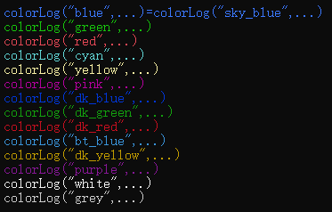

# 💼 Script Helper API

> This section covers commonly used **auxiliary functions** for tasks such as plugin registration, console output, and asynchronous execution.

These functions simplify script development by handling many of the underlying details for you.

## 💼 Script Assist API

The following APIs provide essential helper interfaces for scripts.

### Output Information To The Console

`log(data1,data2,...)`

- Parameter:
    - Variables or data to output.  
      Accepts any number of parameters of any type.
- Return value: none

### Output Color Text

This is an enhanced version of the function above that supports colored output.

`colorLog(color,data1,data2,...)`

- Parameter:
    - color : `String`  
      The output color for this line (see the example and result below).
    - data... :
      Variables or data to output.  
      Accepts any number of parameters of any type.
- Return value: none

#### Show results:

### Asynchronous Output

This function returns immediately after sending the output request, avoiding the blocking delay of synchronous I/O.
Because the underlying implementation uses locks, output from different `fastLog` calls will not interleave.

`fastLog(data1,data2,...)`

- Parameter:
    - data... :
      Variables or data to output.
      Accepts any number of parameters of any type.
- Return value: none

### Delay the execution of a function for a period of time

`setTimeout(func,msec)`

- Parameter:

    - func : `Function`  
      The function to execute.

    - msec : `Integer`  
      The delay before execution, in milliseconds.
- Return value: the task ID.
- Return value type: `Integer`
    - Returns `Null` if the task failed.

### Delay the execution of a code segment for a period of time (eval)

`setTimeout(code,msec)`

- Parameter:

    - code : `String`  
      The code segment to execute.

    - msec : `Integer`  
      The delay before execution, in milliseconds.
- Return value: the task ID.
- Return value type: `Integer`
    - Returns `Null` if task creation failed.

### Set period execution function

`setInterval(func,msec)`

- Parameter:
    - func : `Function`  
      The function to execute.

    - msec : `Integer`  
      The execution interval, in milliseconds (ms).
- Return value: the task ID.
- Return value type: `Integer`

### Set period execution code segment (eval)

`setInterval(code,msec)`

- Parameter:
    - code : `String`  
      The code to execute.

    - msec : `Integer`  
      The execution interval, in milliseconds (ms).
- Return value: the task ID.
- Return value type: `Integer`
    - Returns `Null` if task creation failed.

### Cancel Delay/Period Execution Item

`clearInterval(taskid)`

- Parameter:
    - timerid : `Integer`  
      The task ID returned by one of the preceding functions.
- Return value: whether the cancellation succeeded.
- Return value type: `Boolean`
    - Returns `Null` if canceling the task failed.

