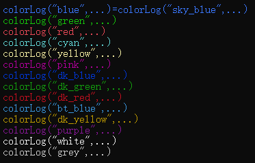

# 💼 脚本辅助 API

> 本节介绍常用的 **辅助功能**，如插件注册、信息输出和异步接口等。

这些功能有助于简化脚本开发，免去处理繁琐细节的困扰。

## 💼 脚本辅助 API

以下 API 为脚本提供了必要的辅助接口。

### 输出信息到控制台

`log(data1,data2,...)`

- 参数：
    - 待输出的变量或数据  
      支持任意类型和任意数量的参数。
- 返回值：无

### 输出带颜色文本

这是上述函数的升级版，支持彩色文本输出。

`colorLog(color,data1,data2,...)`

- 参数：
    - color : `String`  
      此行输出的颜色（代码示例和效果见下图）。
    - data... :
      待输出的变量或数据  
      支持任意类型和任意数量的参数。
- 返回值：无

#### 效果展示：

### 异步输出

此函数在发出输出请求后立即返回，避免同步读写造成的阻塞。  
底层设有锁保护，多次调用 `fastLog` 不会出现字符交错的现象。

`fastLog(data1,data2,...)`

- 参数：
    - data... :
      待输出的变量或数据  
      支持任意类型和任意数量的参数。
- 返回值：无

### 推迟一段时间执行函数

`setTimeout(func,msec)`

- 参数：

    - func : `Function`  
      待执行的函数。

    - msec : `Integer`  
      推迟执行的时间（毫秒）。
- 返回值：此任务的 ID。
- 返回值类型：`Integer`
    - 如果返回 `Null`，则表示创建任务失败。

### 推迟一段时间执行代码段（eval）

`setTimeout(code,msec)`

- 参数：

    - code : `String`  
      待执行的代码段。

    - msec : `Integer`  
      推迟执行的时间（毫秒）。
- 返回值：此任务的 ID。
- 返回值类型：`Integer`
    - 如果返回 `Null`，则表示创建任务失败。

### 设置周期执行函数

`setInterval(func,msec)`

- 参数：
    - func : `Function`  
      待执行的函数。

    - msec : `Integer`  
      执行的间隔周期（毫秒）。
- 返回值：此任务的 ID。
- 返回值类型：`Integer`

### 设置周期执行代码段（eval）

`setInterval(code,msec)`

- 参数：
    - code : `String`  
      待执行的代码段。

    - msec : `Integer`  
      执行的间隔周期（毫秒）。
- 返回值：此任务的 ID。
- 返回值类型：`Integer`
    - 如果返回 `Null`，则表示创建任务失败。

### 取消延时 / 周期执行项

`clearInterval(taskid)`

- 参数：
    - timerid : `Integer`  
      由上述函数返回的任务 ID。
- 返回值：是否取消成功。
- 返回值类型：`Boolean`
    - 如果返回 `Null`，则表示取消任务失败。

