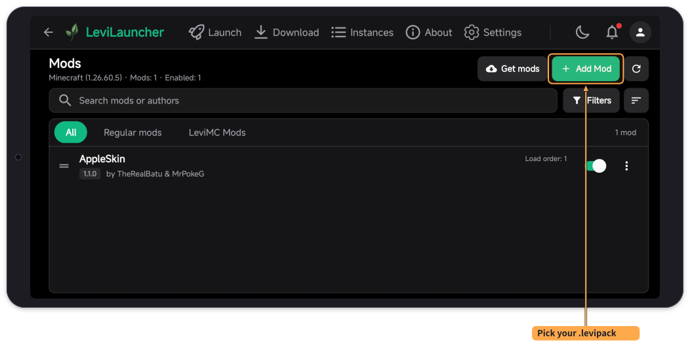

# Your first Android native mod

By the end of this tutorial, you will have a native mod for Minecraft Bedrock on Android: a C++ library built from the official template, packaged as a `.levipack`, imported into LeviLauncher on your phone, and writing your own line to the Android log when the game starts. The mod also includes a setting that you can change from LeviLauncher.

It takes about an hour the first time, most of it spent installing the Android SDK.

::: info Android, not LeviLamina
Android native mods are loaded by the [Android version of LeviLauncher](https://levimc.org/LeviLauncher/guide/mods-integrations?platform=android) through the Preloader SDK ([LiteLDev/preloader-android](https://github.com/LiteLDev/preloader-android)), not by LeviLamina. They use their own `pl::` API. The structure of a mod (`load()`, `enable()`, `disable()`, `getSelf()`) is the same as in [Your first LeviLamina mod](first-levilamina-mod.md).
:::

## What you need

- A PC running Windows, Linux, or macOS, with these tools:
  - [Android Studio](https://developer.android.com/studio), or just its command-line tools, for the Android SDK and NDK;
  - [CMake](https://cmake.org/download/) 3.22 or newer and [Ninja](https://github.com/ninja-build/ninja/releases);
  - [PowerShell 7](https://learn.microsoft.com/powershell/scripting/install/installing-powershell) (Windows PowerShell also works on Windows);
  - a host C++ compiler for the PC itself: Visual Studio with **Desktop development with C++** on Windows, or GCC or Clang on Linux and macOS. The build runs a small program on the PC that generates the mod's default config;
  - [Git](https://git-scm.com).
- An ARM64 Android phone (Android 9 or later) with Minecraft from Google Play and LeviLauncher for Android: see [Play with mods on Android](../play/play-with-mods-android.md).
- Optional: [Android platform tools](https://developer.android.com/tools/releases/platform-tools) (`adb`) and USB debugging enabled on the phone, to read the log.
- Basic knowledge of C++.

## 1. Install the SDK and the NDK

1. In Android Studio, open **Settings** → **Languages & Frameworks** → **Android SDK**. Under **SDK Platforms**, select **Android 9.0 (API 28)**. Under **SDK Tools**, select **Show Package Details** and, under **NDK (Side by side)**, select `28.2.13676358`. Click Apply.
2. Note the **Android SDK Location** at the top of that page, such as `C:\Users\<you>\AppData\Local\Android\Sdk`.
3. In a new terminal, check the other tools:

   ```powershell
   cmake --version
   ninja --version
   ```

You should see CMake 3.22 or later, a Ninja version, and the `ndk\28.2.13676358` folder inside the SDK location.

## 2. Create your repository from the template

1. Open [levilauncher-android-mod-template](https://github.com/QYCottage/levilauncher-android-mod-template) and click **Use this template** → **Create a new repository**, naming it something like `my-android-mod`.
2. Clone it:

   ```powershell
   git clone https://github.com/<you>/my-android-mod
   cd my-android-mod
   ```

3. You should see `CMakeLists.txt`, `manifest.json.in`, `scripts\package.ps1`, and `src\mod\` containing `MyMod.cpp`, `MyMod.h`, `Config.h`, and `Config.cpp`.

## 3. Name your mod

Open `CMakeLists.txt`. Near the top, a few variables describe your mod and populate its `manifest.json`. Change them:

```cmake
set(MOD_ID "my_android_mod" CACHE STRING "LeviLauncher mod package directory name")
set(MOD_NAME "My Android Mod" CACHE STRING "LeviLauncher mod display name")
set(MOD_AUTHOR "<you>" CACHE STRING "LeviLauncher mod author")
set(MOD_VERSION "0.1.0" CACHE STRING "LeviLauncher mod version")
set(MOD_LIBRARY_NAME "my_android_mod" CACHE STRING "Native library name without lib prefix or .so suffix")
set(MOD_MINECRAFT_VERSIONS "[\"1.26.*\"]" CACHE STRING "Raw JSON array for manifest minecraft_versions")
```

- `MOD_ID` is the mod's folder name on the phone. Keep it stable after your first release: LeviLauncher uses it for paths, the Mod Menu, and users' saved settings.
- `MOD_NAME` is the display name in LeviLauncher and the tag for your lines in the Android log.
- `MOD_MINECRAFT_VERSIONS` lists the game versions the mod runs on; `*` matches the rest of a version string. An empty list `[]` matches every version. Make sure this matches the Minecraft version on your phone.

The template's C++ namespace and class are `clange_me` and `ClangeMeMod`. You can rename them later; this tutorial keeps them as they are.

## 4. Write your first line

The template already includes a typed config: the `ModConfig` struct in `src\mod\Config.h` is saved to the mod's `config/config.json`, and its `message` field is written to the log when the mod is enabled. Change the default message:

```cpp
struct ModConfig {
    int version = 1;
    bool enabled = true;
    std::string message = "Hello from my first Android mod!";
};
```

Open `src\mod\MyMod.cpp` to see where it is used. The lifecycle is:

1. `load()` runs when the mod is loaded. Here, the template creates the data and config folders and loads the config.
2. `enable()` runs before the game starts. It logs `Config message: <message>` using `getSelf().getLogger().info(...)`.
3. `disable()` runs when the game closes, and `unload()` runs during final cleanup.

`PL_REGISTER_MOD` at the end of `src\main.cpp` registers the single long-lived instance of the mod.

## 5. Build the .levipack

Set the SDK location and run the packaging script for 64-bit ARM:

::: code-group

```powershell [Windows]
$env:ANDROID_HOME = "C:/Users/<you>/AppData/Local/Android/Sdk"
./scripts/package.ps1 -Abi arm64-v8a
```

```shell [Linux and macOS]
export ANDROID_HOME="$HOME/Android/Sdk"     # macOS: $HOME/Library/Android/sdk
pwsh ./scripts/package.ps1 -Abi arm64-v8a
```

:::

On Windows, run this in **Developer PowerShell for VS** so CMake can find the PC compiler. The first build downloads the Preloader SDK and a few libraries.

The build produces `build-arm64-v8a\my_android_mod-0.1.0-arm64-v8a.levipack`. A `.levipack` is a ZIP file containing a `my_android_mod\` folder with `manifest.json`, `libmy_android_mod.so`, and `config\`.

::: tip Let GitHub build it
The template includes a workflow in `.github\workflows\build.yml`. After you push, the **Actions** tab of your repository builds the `.levipack` files and uploads them as an artifact; pushing a `v*` tag also attaches them to a release.
:::

## 6. Import it into LeviLauncher

1. Copy the `.levipack` to your phone's **Download** folder over USB or by any other method.
2. Open LeviLauncher. On the **Launch** page, tap **Manage** on the **Mods** card to open the **Mods** page for the current instance.
3. Tap **Add Mod** and select your `.levipack` in the file picker. You should see "Successfully processed 1 mod files". (You can also open the `.levipack` from a file manager and select LeviLauncher.)

   

4. **My Android Mod** should now appear in the mod list at version `0.1.0`, with its toggle enabled.

New to LeviLauncher on Android? [Play with mods on Android](../play/play-with-mods-android.md) walks through it step by step.

## 7. Check that it runs

1. Launch the game from LeviLauncher.
2. With your phone connected over USB, read the Android log on your PC:

   ::: code-group

   ```powershell [Windows]
   adb logcat | Select-String "My Android Mod"
   ```

   ```shell [Linux and macOS]
   adb logcat | grep "My Android Mod"
   ```

   :::

   You should see a line containing `Config message: Hello from my first Android mod!`.

3. Return to LeviLauncher and open your mod's details. It now has a configuration: change **Message** to something else and save. Launch the game again, and the log will show the new message.

No `adb`? Step 3 still confirms the mod ran: the configuration file exists only because your mod executed `load()` and saved it.

## What you have now

- A repository with an Android native mod that builds a `.levipack` both locally on your PC and on GitHub.
- The mod installed in LeviLauncher, logging to Android and exposing a user-configurable setting.

## Next steps

- The lifecycle in detail: [Mod API](https://levimc.org/LeviLamina/developer_guides/android/api/mod/).
- More settings, with titles, descriptions, and limits: [Config API](https://levimc.org/LeviLamina/developer_guides/android/api/config/).
- In-game buttons and switches: [Mod Menu API](https://levimc.org/LeviLamina/developer_guides/android/api/mod_menu/). Touch and key input: [Input API](https://levimc.org/LeviLamina/developer_guides/android/api/input/).
- Changing game behavior: [Hook API](https://levimc.org/LeviLamina/developer_guides/android/api/hook/).
- SDK headers and macros: [SDK headers and macros](https://levimc.org/LeviLamina/developer_guides/android/api/types_and_macros/).
- A complete example with a Mod Menu, buttons, and images: `examples/full-cpp-mod` in [LiteLDev/LeviLauncher-Android](https://github.com/LiteLDev/LeviLauncher-Android).
- Native mods in LeviLauncher from the player's perspective: [Mods & Integrations](https://levimc.org/LeviLauncher/guide/mods-integrations?platform=android).
