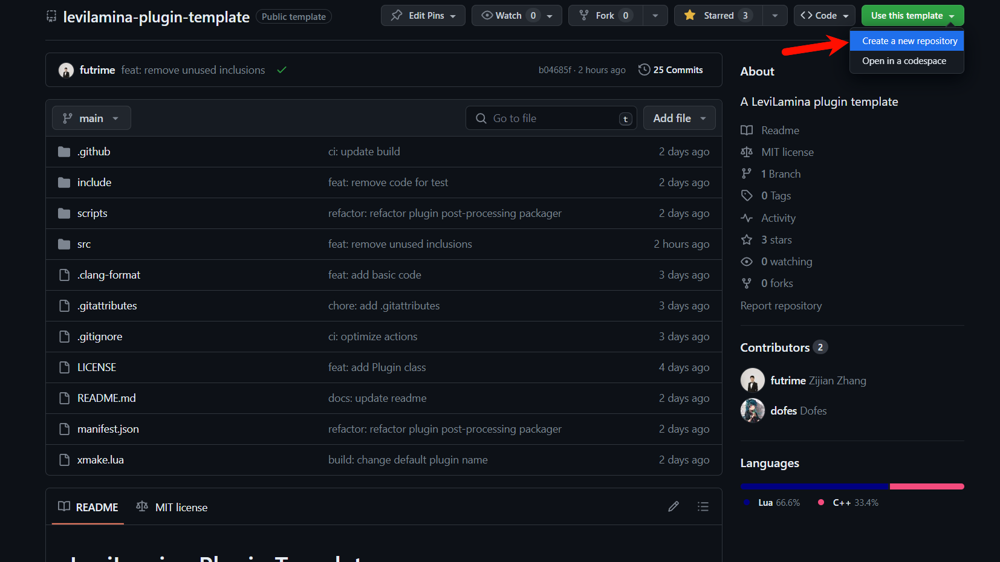

# Your first LeviLamina mod

By the end of this tutorial, you will have your own LeviLamina mod written in C++: a repository created from the official mod template, built on your PC, and loaded by your server. The mod prints a line to the server console on startup and adds a `/hello` command that greets whoever runs it.

The first time takes about an hour, mostly spent installing tools and waiting for the initial build to download LeviLamina.

## What you need

- A Windows 10 or 11 PC (x64). Mods are built with Windows tools.
- Basic C++. If you are new to it, [cppreference.com](https://en.cppreference.com/) and the [C++ Developer Roadmap](https://roadmap.sh/cpp) are good starting points.
- A GitHub account to create your repository from the template.
- A server with LeviLamina for testing: [Your first server](../server/first-server.md). This tutorial uses `D:\servers\survival`.

## 1. Install the tools

Install these tools, keeping the default options:

1. [Git](https://git-scm.com).
2. [Visual Studio](https://visualstudio.microsoft.com/) (the free Community edition is enough). In the installer, check the **Desktop development with C++** workload, which includes the Windows SDK and C++ libraries.
3. [LLVM](https://github.com/llvm/llvm-project/releases/latest), using the `LLVM-<version>-win64.exe` installer. When prompted, add LLVM to the `PATH`. The template compiles with `clang-cl` from LLVM.
4. [xmake](https://xmake.io), the build tool for LeviLamina mods.
5. Optional, for editing: [Visual Studio Code](https://code.visualstudio.com) with the [C/C++](https://marketplace.visualstudio.com/items?itemName=ms-vscode.cpptools), [XMake](https://marketplace.visualstudio.com/items?itemName=tboox.xmake-vscode), and [clangd](https://marketplace.visualstudio.com/items?itemName=llvm-vs-code-extensions.vscode-clangd) extensions.

Open a **new** terminal and verify that the tools are available:

```powershell
git --version
clang-cl --version
xmake --version
```

You should see three version numbers. If any command is not recognized, reinstall that tool, make sure it adds itself to the `PATH`, and open a new terminal.

## 2. Create your repository from the template

1. Open [LiteLDev/levilamina-mod-template](https://github.com/LiteLDev/levilamina-mod-template) and click **Use this template** → **Create a new repository**. Give it a name, such as `my-mod`, and make it public if you plan to publish it later.

   
2. Clone the repository into your projects folder:

   ```powershell
   mkdir D:\projects
   cd D:\projects
   git clone https://github.com/<you>/my-mod
   cd my-mod
   ```

3. You should see `xmake.lua`, `lip.toml`, `manifest.json`, and the `src\mod\` folder containing `MyMod.cpp` and `MyMod.h`, among other files.

## 3. Name your mod

1. Open `xmake.lua`. The `target` sets the name of your mod: LeviLamina displays this name, and it is also used as the mod's folder name. Use only letters, digits, and `-`, with no spaces:

   ```lua
   target("my-mod") -- Change this to your mod name.
   ```

   This tutorial keeps `my-mod`.

2. In the same file, pin the LeviLamina version to build against. Its first two version numbers must match the LeviLamina version on your server. To check your server's version, run `lip list` in the server folder; it will show a line such as `github.com/LiteLDev/LeviLamina@26.60.3`. Then set:

   ```lua
   add_requires("levilamina 26.60.*", {configs = {target_type = get_config("target_type")}})
   ```

3. Update the copyright holder in `LICENSE`, or replace the file with your preferred license. Because the template itself is CC0, you are free to choose any license.

You can also rename the `my_mod` namespace and the `MyMod` class in `src\mod\`, though that is not necessary for this tutorial.

## 4. Build the empty mod

Before writing any code, verify that the template builds. In the repository folder, run:

```powershell
xmake f -y -p windows -a x64 -m release
xmake
```

The first command configures the build for a server mod (the default; `--target_type=client` builds a client mod). On the first run, it downloads LeviLamina and its dependencies, which takes several minutes. The second command compiles the mod.

The output should end with `build ok`, and you should now have a `bin\my-mod\` folder containing `my-mod.dll` and `manifest.json`.

::: details Downloads fail
xmake downloads packages from GitHub. If your network cannot reach GitHub, configure a [GitHub mirror](https://xmake.io/guide/package-management/network-optimization.html#mirror-proxy) or an [HTTP proxy](https://xmake.io/guide/package-management/network-optimization.html#proxy-setting) for xmake, then run both commands again. If xmake cannot find the LeviLamina version you pinned, run `xmake repo -u` to refresh the package list.
:::

## 5. Add a log line and a command

LeviLamina calls three functions on a mod in order: `load()`, `enable()`, and `disable()`. Because the game is not ready during `load()`, use it only for game-independent work such as reading a config file. Register commands and listen for events in `enable()` or later.

You register commands when the game asks for them by firing `ServerCommandRegisterEvent`. Replace the contents of `src\mod\MyMod.cpp` with:

```cpp
#include "mod/MyMod.h"

#include "ll/api/command/CommandHandle.h"
#include "ll/api/command/CommandRegistrar.h"
#include "ll/api/event/EventBus.h"
#include "ll/api/event/command/ServerCommandRegisterEvent.h"
#include "ll/api/mod/RegisterHelper.h"
#include "mc/server/commands/CommandOrigin.h"
#include "mc/server/commands/CommandOutput.h"
#include "mc/server/commands/CommandPermissionLevel.h"
#include "mc/world/actor/player/Player.h"

namespace my_mod {

MyMod& MyMod::getInstance() {
    static MyMod instance;
    return instance;
}

bool MyMod::load() {
    getSelf().getLogger().debug("Loading...");
    return true;
}

bool MyMod::enable() {
    getSelf().getLogger().info("Hello from my first mod!");

    using namespace ll::event;
    EventBus::getInstance().emplaceListener<ServerCommandRegisterEvent>([](ServerCommandRegisterEvent&) {
        auto& command = ll::command::CommandRegistrar::getInstance(false) // false: a server command
                            .getOrCreateCommand("hello", "Says hello.", CommandPermissionLevel::Any);
        command.overload().execute([](CommandOrigin const& origin, CommandOutput& output) {
            auto* entity = origin.getEntity();
            if (entity == nullptr || !entity->isPlayer()) {
                output.success("Hello, console!"); // run from the console or a command block
                return;
            }
            auto* player = static_cast<Player*>(entity); // safe: isPlayer() was checked
            output.success("Hello, {}!", player->getRealName());
        });
    });
    return true;
}

bool MyMod::disable() {
    getSelf().getLogger().debug("Disabling...");
    return true;
}

} // namespace my_mod

LL_REGISTER_MOD(my_mod::MyMod, my_mod::MyMod::getInstance());
```

What the code does:

- `getLogger().info(...)` writes a line to the server console, tagged with your mod's name.
- `emplaceListener` subscribes to an event. LeviLamina automatically removes the listener when the mod is disabled.
- `getOrCreateCommand` creates `/hello`; `CommandPermissionLevel::Any` lets every player run it (`GameDirectors` would restrict it to operators).
- `overload().execute(...)` registers the no-argument form of `/hello` and the code that runs when it is called.

::: warning Game types have no RTTI
Minecraft is built without run-time type information, so `dynamic_cast` does not work on its classes. Check the type first, as `isPlayer()` does here, and then use `static_cast`.
:::

Build again with `xmake`. You should see `build ok` again.

## 6. Load the mod on your server

1. Stop the server if it is running.
2. Copy the `bin\my-mod` folder into the server's `mods` folder so that you have `D:\servers\survival\mods\my-mod\my-mod.dll`:

   ```powershell
   Copy-Item -Recurse -Force bin\my-mod D:\servers\survival\mods\
   ```

3. Start the server, as shown in [Your first server](../server/first-server.md) or by running `lip run` in its folder.
4. In the output, after the lines where LeviLamina loads the mods, you should see a line containing `[my-mod]` and `Hello from my first mod!`.
5. Type `hello` into the server console (console commands do not use a leading `/`). You should see `Hello, console!`.
6. Join the server from Minecraft (address `127.0.0.1`, port `19132`) and type `/hello` in the chat. You should see `Hello, <your name>!`.

After each change, stop the server, run `xmake`, copy the folder again, and restart the server.

::: tip Error codes when the mod does not load
If LeviLamina reports an error such as 126 or 127 instead of loading `my-mod`, the mod was usually built against a different LeviLamina version than the server's. Check the version pin from step 3. [LeviLamina troubleshooting](https://levimc.org/faq/server/levilamina/errors/) explains the error codes.
:::

## What you have now

- A Git repository with your mod, which builds with `xmake`.
- A mod loaded by your server that logs a line and registers a command.
- `lip.toml` and a release workflow in `.github\workflows\`, ready for publishing.

## Next steps

- Let others install your mod with one command: [Publish your mod with lip](publish-a-package.md).
- A larger example with config files, a database, a form, and items: [ShrBox/ExampleMod](https://github.com/ShrBox/ExampleMod).
- Commands with arguments: [Command guide](https://levimc.org/LeviLamina/developer_guides/how_to_guides/command_guide/).
- React to what players do: [Event guide](https://levimc.org/LeviLamina/developer_guides/how_to_guides/event_guide/).
- Prompt players with dialogs: [Form guide](https://levimc.org/LeviLamina/developer_guides/how_to_guides/form_guide/).
- Change how the game behaves: [Hook guide](https://levimc.org/LeviLamina/developer_guides/how_to_guides/hook_guide/).
- Every class and function: [LeviLamina API](https://levimc.org/LeviLamina/api/).
- Questions developers often ask: [Developer FAQ](https://levimc.org/faq/develop/levilamina/basics/).
- Prefer a scripting language: [Your first script plugin](first-script-plugin.md).
