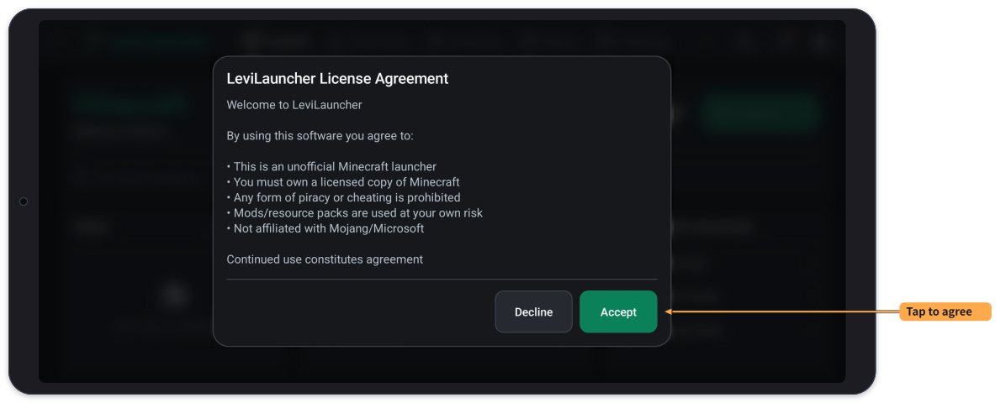
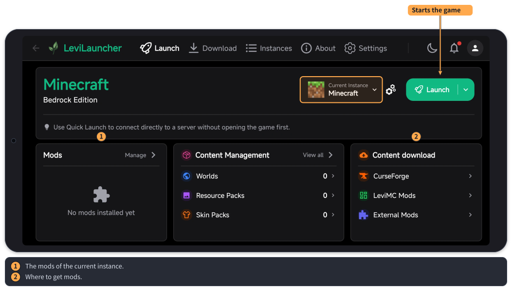
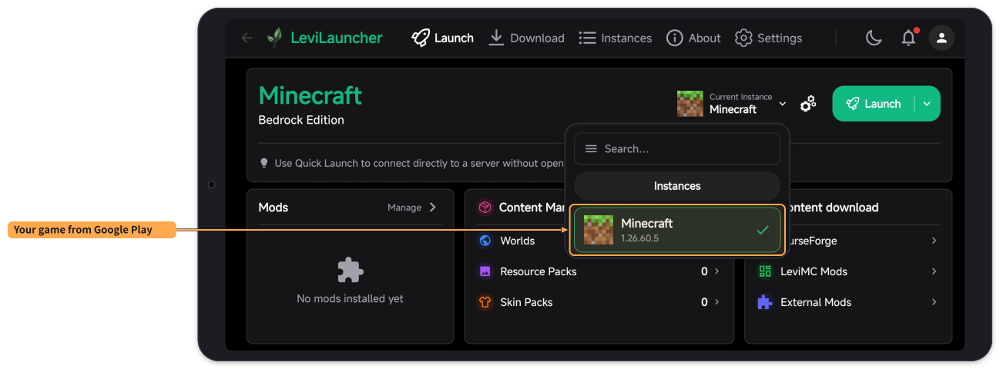
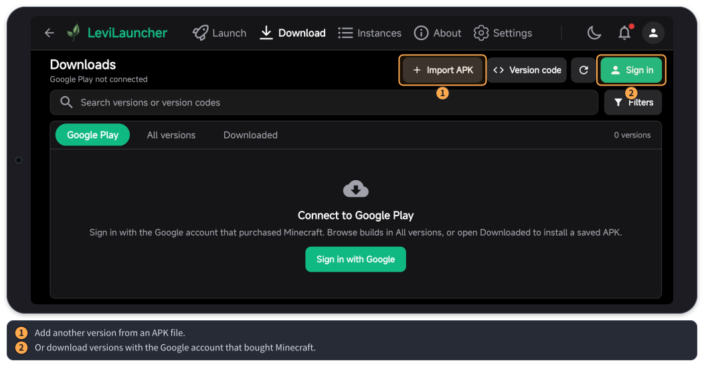
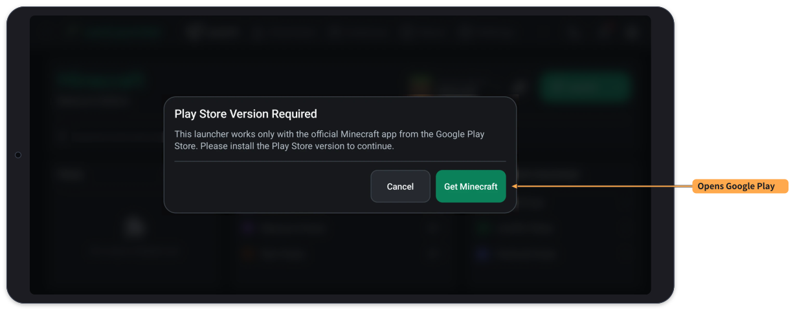
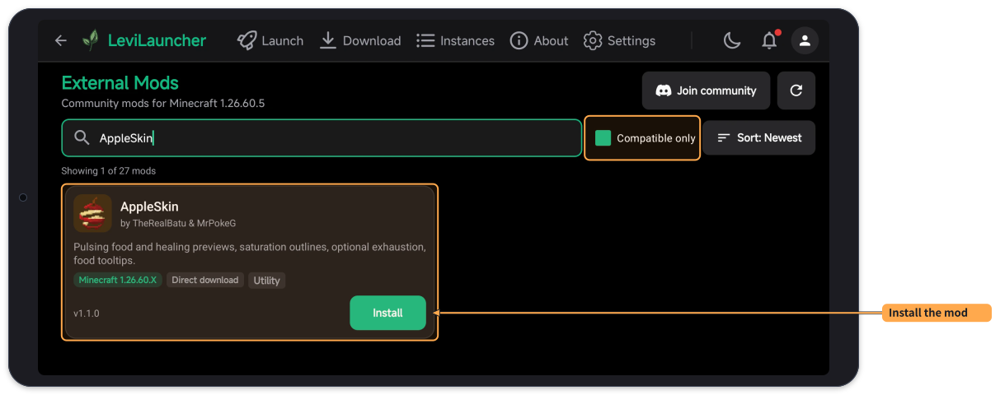
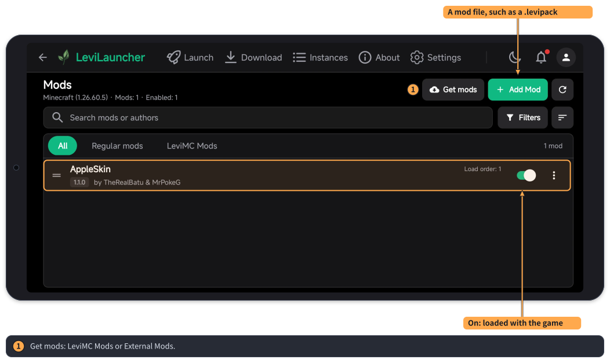
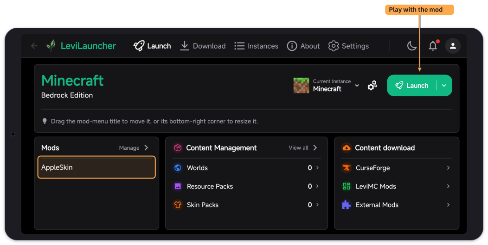
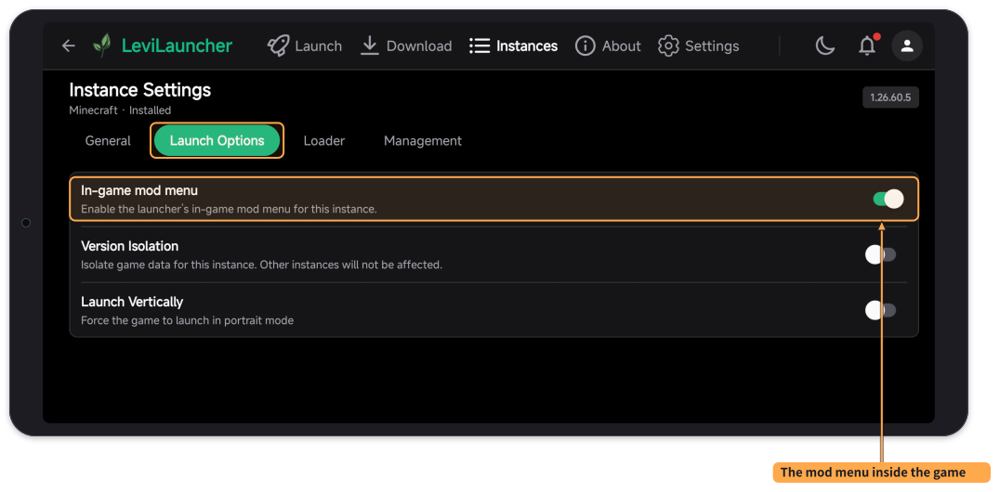
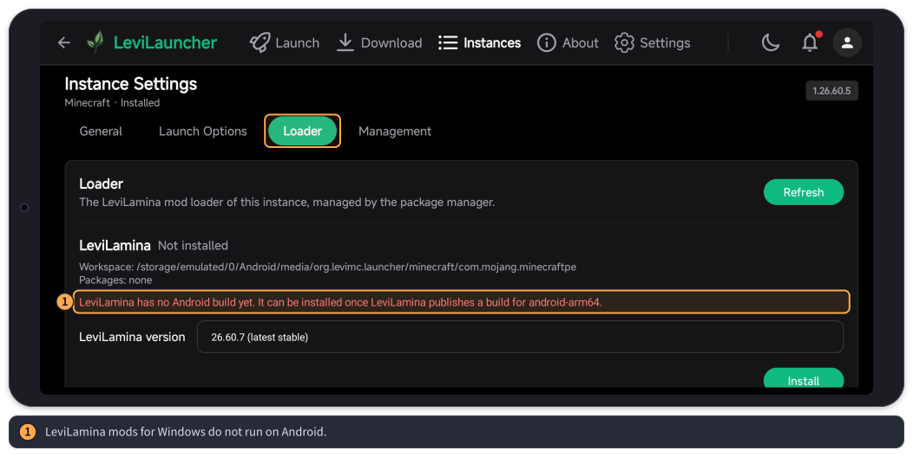

# Play with mods on Android

By the end of this tutorial, you will be playing Minecraft Bedrock Edition on your Android phone or tablet with a mod, AppleSkin, launched from LeviLauncher. LeviLauncher uses the copy of Minecraft you bought on Google Play, keeps the mods for each instance separate, and installs mods for you: you need nothing else.

Mods on Android are native mods built for Android. LeviLamina and LeviLamina mods for Windows do not run on Android (see step 7 for details).

## What you need

- An Android phone or tablet running Android 9 or later with a 64-bit ARM processor (ARM64). Almost every phone from recent years has one.
- Minecraft Bedrock Edition 1.21.80 or later, **bought and installed from Google Play** on this device. LeviLauncher launches your game; it does not replace the license, and it does not work with Minecraft installed from anywhere else.
- An internet connection.

## 1. Install LeviLauncher

1. On your phone, open the [latest release of LeviLauncher for Android](https://github.com/LiteLDev/LeviLauncher-Android/releases/latest) and download `LeviLauncher-v….apk` (the file ending in `-release.apk`).
2. Open the downloaded file. If Android says that your browser is not allowed to install apps, tap **Settings**, turn on **Allow from this source** (the browser's "Install unknown apps" setting), go back, and tap **Install**.
3. Open LeviLauncher. You should see "Opening your launcher…", followed by its license agreement.

For older versions and updates, see [Install LeviLauncher](https://levimc.org/LeviLauncher/install?platform=android).

## 2. Go through the first start

1. Read the **LeviLauncher License Agreement** and tap **Accept**.

   

2. If **What’s new** opens, tap **Continue**.
3. You should now see the **Launch** page. The bar at the top leads to **Launch**, **Download**, **Instances**, **About**, and **Settings**. The round button at the top right signs in to a Microsoft account; you do not need it for this tutorial.

   

## 3. Check your game

An instance is a version of the game with its own mods. LeviLauncher finds the Minecraft you installed from Google Play and shows it as the **Minecraft** instance.

1. On **Launch**, look at **Current Instance**: it says **Minecraft**.
2. Tap it. The list shows your game with its version, for example `1.26.60.5`, and a check mark. Tap outside the list to close it.

   

If the list is empty, Minecraft is not installed: install it from Google Play and open LeviLauncher again.

::: tip Other versions of the game
You can also play other versions alongside your Google Play game. On **Download**, tap **Import APK** to add a version from an APK file, or **Sign in** with the Google account that bought Minecraft to download versions from Google Play. Each one becomes an instance that keeps its worlds separate from your normal game. They still require the Google Play game on the device. You do not need any of them for this tutorial.

:::

## 4. Launch the game once

1. On **Launch**, tap **Launch**.
2. Minecraft starts, and you should see its title screen. Close the game again: in the next step, you will add a mod.

Launching the game once without mods confirms that the game itself works. If something goes wrong later, you will know the mod caused it.

If LeviLauncher shows **Play Store Version Required**, the copy of Minecraft on your device was not installed from Google Play. Tap **Get Minecraft**, install the game from Google Play with the account that bought it, and tap **Launch** again. If it says **Unsupported Version** instead, update Minecraft on Google Play: LeviLauncher requires 1.21.80 or later.

## 5. Install a mod

1. On **Launch**, in the **Content download** card, tap **External Mods**. This page lists community-made Android mods for your current instance's version.
2. Keep **Compatible only** checked so you see only mods for your game version. Tap the search box and type `AppleSkin`.
3. On the AppleSkin card, tap **Install**. You should see "AppleSkin installed", and the button changes to **Installed**.

   

4. Go back to **Launch** and tap **Manage** on the **Mods** card. The **Mods** page lists AppleSkin and its version with its switch turned on, meaning the mod loads with the game.

   

If AppleSkin is not in the list, there is no build for your game version. Pick another mod from the list, or update Minecraft.

Some mods in **External Mods** must be downloaded from the author's page instead. Their button says **Open Link**, and displays **External Download** or **Ad-Supported Download** first. Tap **Open Link** there and download only the mod file (a `.levipack` or `.so` file). Then return to the **Mods** page, tap **Add Mod**, and choose the file. You should see "Successfully processed 1 mod files". You can also open a `.levipack` file from a file manager and choose LeviLauncher.

## 6. Play with the mod

1. On **Launch**, the **Mods** card now lists AppleSkin. Tap **Launch**.

   

2. Minecraft starts with AppleSkin. Open a world and look at your hunger bar: when you hold food, AppleSkin shows how much hunger it restores.

Add more mods one at a time, and launch the game after each one. If the game fails to start, turn off the switch for the newest mod on the **Mods** page first.

::: tip The mod menu in the game
LeviLauncher adds a floating button to the game that opens a menu for your mods and their options. To turn it off or on, tap the gear next to **Current Instance** on **Launch** to open **Instance Settings**, go to **Launch Options**, and use the **In-game mod menu** switch.

:::

## 7. Know what runs on Android

Mods for LeviLamina—the mod loader for the Windows game and servers—are built for Windows. They do not run on Android, and LeviLamina itself has no Android build yet (as the **Loader** tab in **Instance Settings** notes if you try to install it). Use mods from **External Mods**, or other mods made for Android.

**LeviMC Mods** in the **Content download** card lists packages from [LeviMC Mods](https://levimc.org/mods/) that have an Android build (`android-arm64`). There are none yet, so this list is currently empty.

## What you have now

- LeviLauncher, which launches the Minecraft you bought on Google Play with mods.
- AppleSkin, installed in your instance, with a switch to turn it off.

## Next steps

- Everything about instances—other versions, Version Isolation, renaming, and deleting: [Version Management](https://levimc.org/LeviLauncher/guide/version-management?platform=android).
- Worlds, resource packs, and skin packs, including import, export, and backups: [Content Management](https://levimc.org/LeviLauncher/guide/content-management?platform=android).
- Mods, CurseForge, and native mods: [Mods & Integrations](https://levimc.org/LeviLauncher/guide/mods-integrations?platform=android).
- When the game does not start: [Update & Troubleshooting](https://levimc.org/LeviLauncher/guide/update-troubleshooting?platform=android).
- Make an Android mod yourself: [Your first Android native mod](../develop/first-android-mod.md).
- Play with mods on a PC: [Play with mods on Windows](./play-with-mods.md).
