# Play with mods on Windows

By the end of this tutorial, you will be playing Minecraft Bedrock Edition on Windows with LeviLamina and a mod in a LeviLauncher instance that keeps its worlds and settings separate from your normal game. LeviLauncher installs the game version, LeviLamina, and the mods for you—you do not need `lip` or anything else.

## What you need

- Windows 10 or Windows 11, 64-bit.
- Minecraft Bedrock Edition, purchased on the Microsoft account you sign in with and installed from the Microsoft Store at least once on this PC. LeviLauncher manages your game; it does not replace your license.
- An internet connection.

## 1. Install LeviLauncher

1. Open the [latest release of LeviLauncher](https://github.com/LiteLDev/LeviLauncher/releases/latest) and download `LeviLauncher-amd64-installer.exe`.
2. Run the installer and finish the setup wizard. If it asks to install WebView2 or another component, let it continue.
3. Start LeviLauncher. You should see its window, with a column of icons on the left: **Launch**, **Download**, **Instances**, **About**, and **Settings** (hover over an icon to see its name). On the first run, it opens to **First Launch Setup**.

For the other release files, beta versions, and updates, see [Install LeviLauncher](https://levimc.org/LeviLauncher/install?platform=windows).

## 2. Go through the first launch

1. In **First Launch Setup**, **Base Root** under **Content Paths** sets where LeviLauncher stores your instances. Keep it on a drive with a few GB of free space; to change it, click **Browse…**, choose a folder, and click **Apply**. **Language** sets LeviLauncher's display language.

   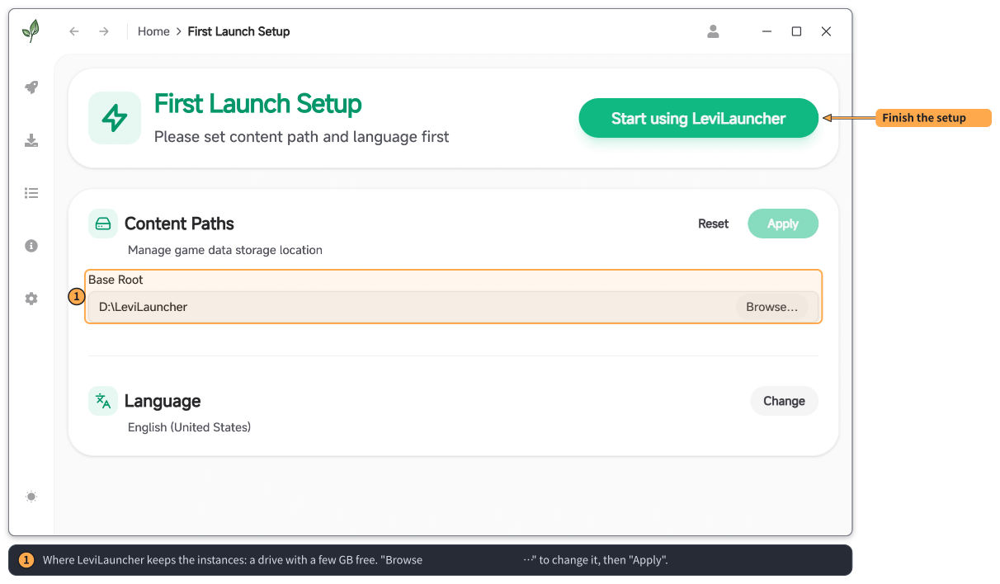

2. Click **Start using LeviLauncher**.
3. LeviLauncher displays the **LeviLauncher License Agreement**. Read it, then click **Agree and Continue** once the button becomes available.
4. LeviLauncher asks **Help improve LeviLauncher?**, which controls whether it can send usage statistics (Google Analytics). Choose **Allow and Enable** or **Not Now**; you can change this later in **Settings**.

You are done with this step when the **Launch** page appears. Its main button says **Download Minecraft** because you have no instances yet.

## 3. Install a game version with LeviLamina

1. Open **Download** in the sidebar.
2. You should see the GDK versions of Minecraft's standard releases: **GDK** (the package type) and **Release** (under **Types**) are selected by default. LeviLamina can be installed automatically only on supported GDK versions.
3. Find the newest version that lists LeviLamina in the **Loader** column and click its **Download** button. Because new game versions often come out before LeviLamina supports them, this is not always the top row.

   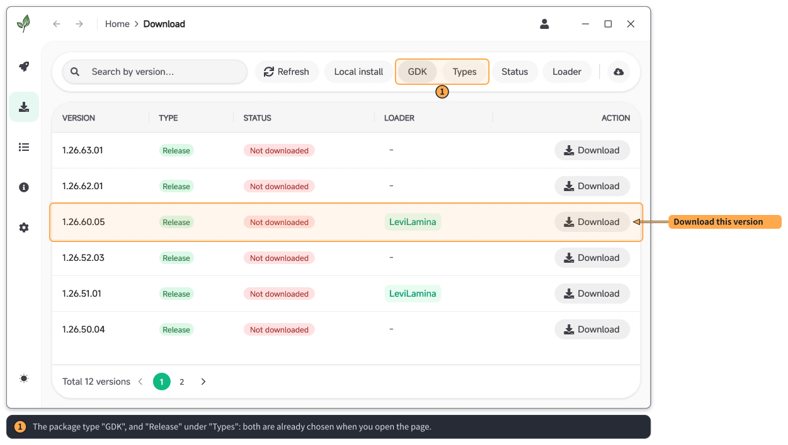

4. In **Select Download Mirror**, LeviLauncher tests the mirrors and selects the fastest one. Click **Download from Selected Mirror**.

   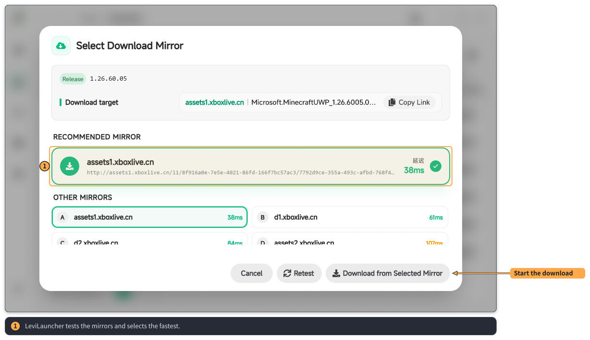

5. Wait for the download (a few GB) to finish. When it completes, you should see **Download complete**. Click **Install now**. (Later, this version's row will show **Downloaded**, and its **Install** button will do the same thing.)

   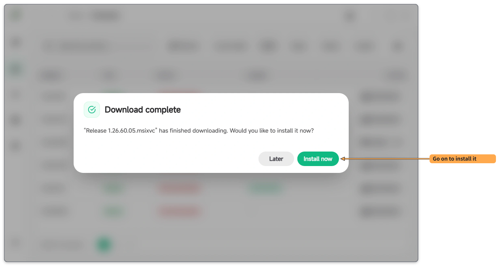

6. On the **Install Instance** page:
   - Enter a name for the instance under **Instance Name**, such as `Survival`.
   - Leave **Install LeviLamina** enabled, with the newest **LeviLamina Version** selected.
   - Leave **Instance isolation** enabled so that this instance keeps its worlds, settings, and caches in its own folder.

   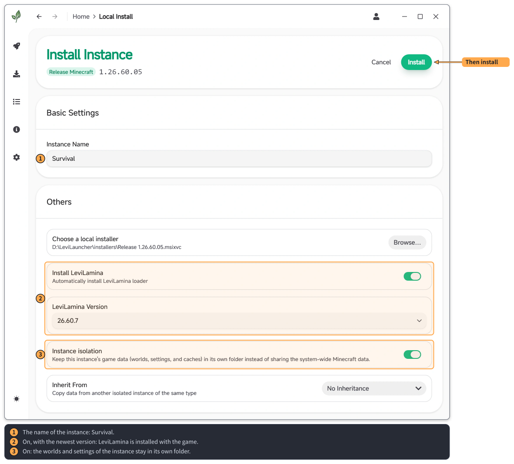

7. Click **Install** at the top of the page and wait. You should see **Install Complete** and "Installation completed successfully." Click **Select and go to launch**.

If the page does not show **Install LeviLamina**, LeviLamina does not support that version. Go back to **Download** and pick a version that lists LeviLamina in the **Loader** column.

## 4. Launch the game

1. On the **Launch** page, check that **Current Instance** shows the instance you just installed, with a LeviLamina badge next to **Minecraft**. If it does not, select it in the instance picker.

   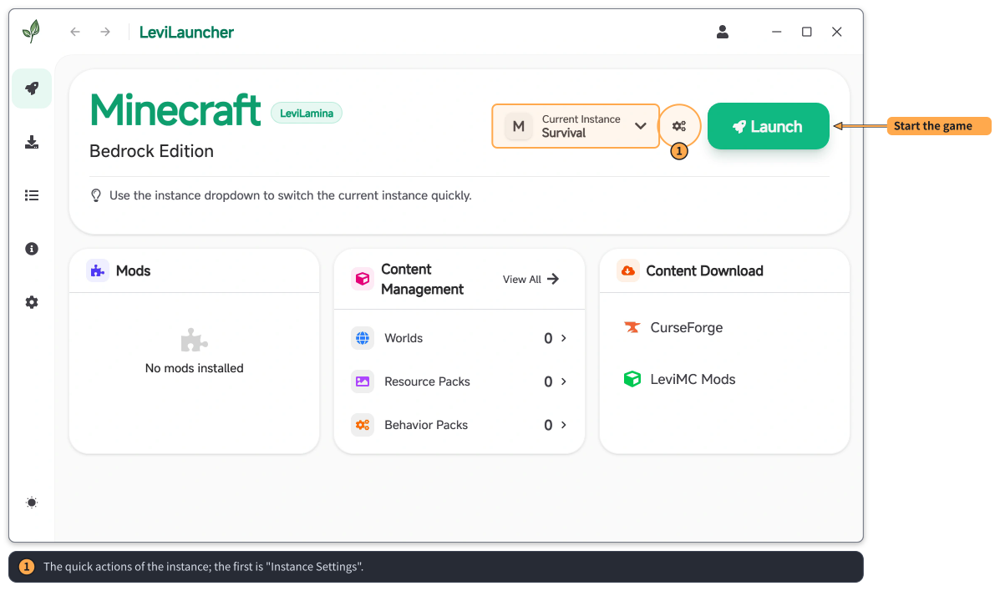

2. Click **Launch**.
3. If a required component is missing, LeviLauncher prompts you to install it instead: **GameInput Component Missing**, **Microsoft Gaming Services Missing**, or **Visual C++ Runtime Missing**. Click **Install Now** (or **Open Store to Install** for Gaming Services), follow the installer, and click **Launch** again.

   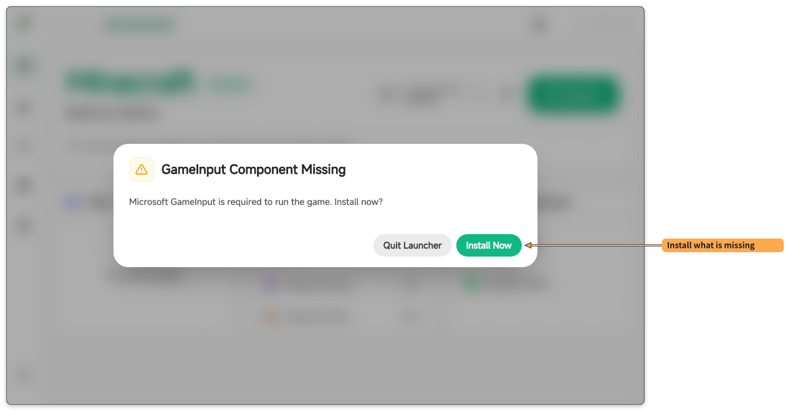

4. Minecraft starts. Once you see the title screen, close the game—you will add a mod in the next step.

If LeviLauncher says "This account does not own this version.", the current Microsoft account has not bought Minecraft. Click the person icon in the top-right corner (**Sign in with Microsoft**, or **Switch account** if an account is already signed in), sign in with the account that owns the game, and launch again.

Launching without mods first confirms that the instance itself works. If something goes wrong later, you know a mod caused it.

## 5. Install a mod

1. On the **Launch** page, open **LeviMC Mods** from the **Content Download** card. This page lists the mods from [LeviMC Mods](https://levimc.org/mods/) that have a Windows client build for your instance's LeviLamina version.
2. Type `LeviOptimize` in **Search mods…** and open LeviOptimize.

   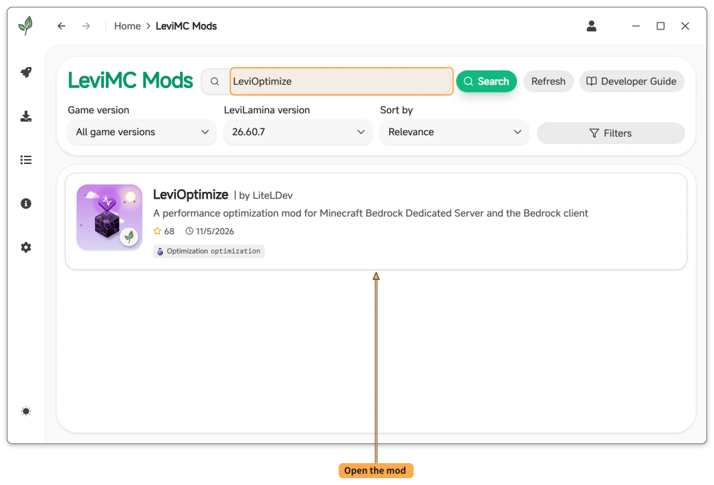

3. Click **Install**. LeviLauncher shows the mod's **Versions** with the `client` variant (the build for the game). Click **Install** on the latest version for your game version.

   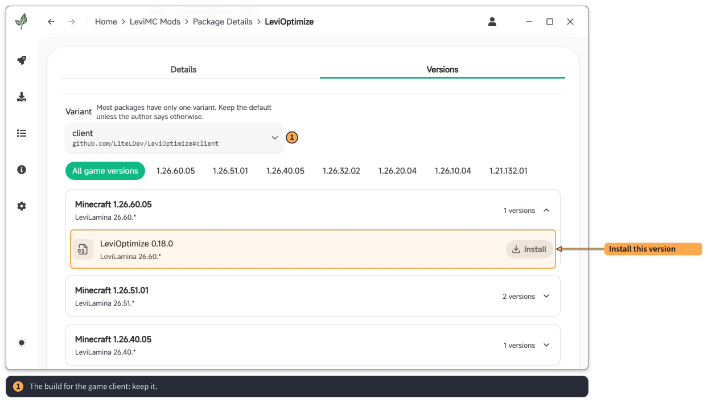

4. In **Select Target Instance**, confirm that your instance is selected and click **Install**. LeviLauncher installs the mod and its dependencies.

   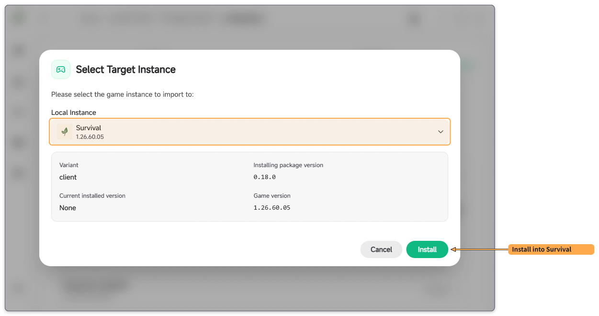

5. You should see "Installation completed successfully". Back on the **Launch** page, the instance's **Mods** card now lists LeviOptimize.

To add a mod from a file, click **Manage Mods** on the **Mods** card, then click **Import .mcmod**. To import a `.zip` or a standalone `.dll`, select **All files (\*.\*)** in the file picker.

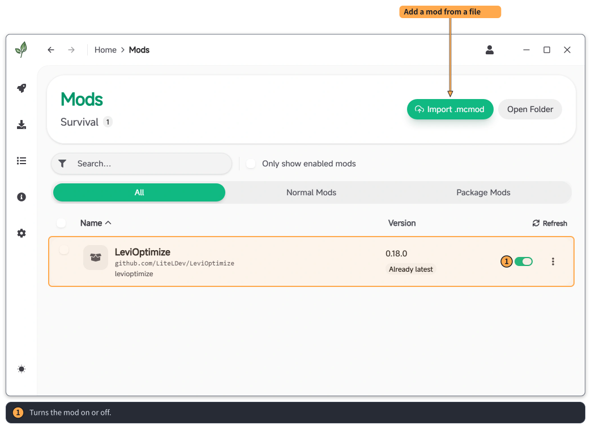

## 6. Play with the mod

1. On the **Launch** page, check **Current Instance** and click **Launch**.
2. Minecraft starts with LeviLamina and LeviOptimize loaded. Open a world and play.

Add further mods one at a time, launching the game after each one. If the game fails to start, disable the most recently added mod first using its toggle on the **Mods** page (**Manage Mods**).

::: tip Change LeviLamina later
To install, update, or remove LeviLamina in an existing instance, click the gear button (quick actions) next to the instance picker on the **Launch** page, select **Instance Settings**, and open the **Loader** tab. If LeviLamina does not support the instance's game version, the tab displays "LeviLamina is not supported for this game version".

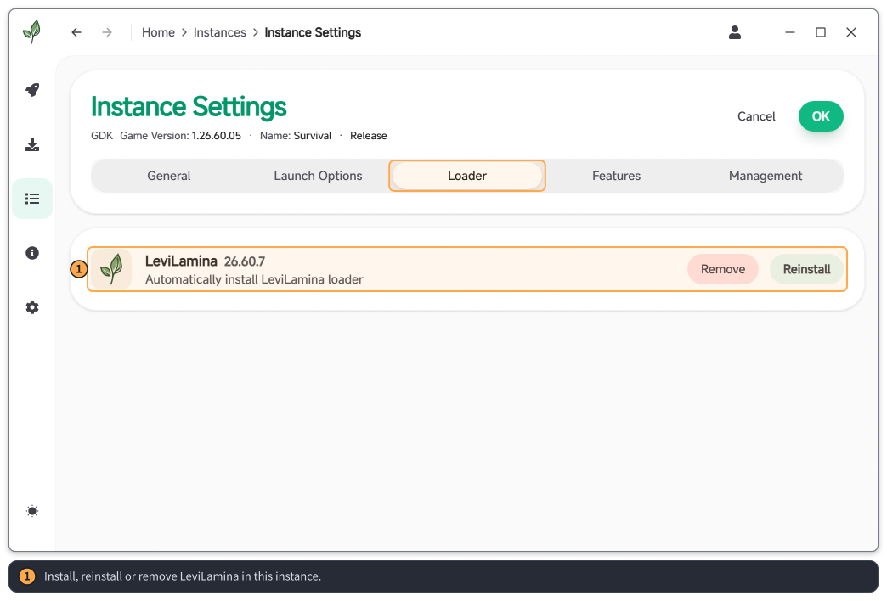
:::

## What you have now

- LeviLauncher, which installs and launches Minecraft versions.
- An isolated instance running LeviLamina and LeviOptimize, keeping its worlds and settings separate from your normal game.

## Next steps

- Join a modded server or run your own: [Your first server](../server/first-server.md).
- Learn everything the launcher's mods page can do, including CurseForge and the built-in package manager: [Mods & Integrations](https://levimc.org/LeviLauncher/guide/mods-integrations).
- Use mirrors, the download list, and local installers: [Downloads & Mirrors](https://levimc.org/LeviLauncher/guide/downloads-mirrors).
- Rename, delete, and organize instances: [Version Management](https://levimc.org/LeviLauncher/guide/version-management).
- Manage worlds, resource packs, and behavior packs: [Content Management](https://levimc.org/LeviLauncher/guide/content-management).
- Fix failed downloads or a game that will not start: [Update & Troubleshooting](https://levimc.org/LeviLauncher/guide/update-troubleshooting).
- Play on your Android phone or tablet: [Play with mods on Android](./play-with-mods-android.md).
- Create your own mod: [Your first LeviLamina mod](../develop/first-levilamina-mod.md).
