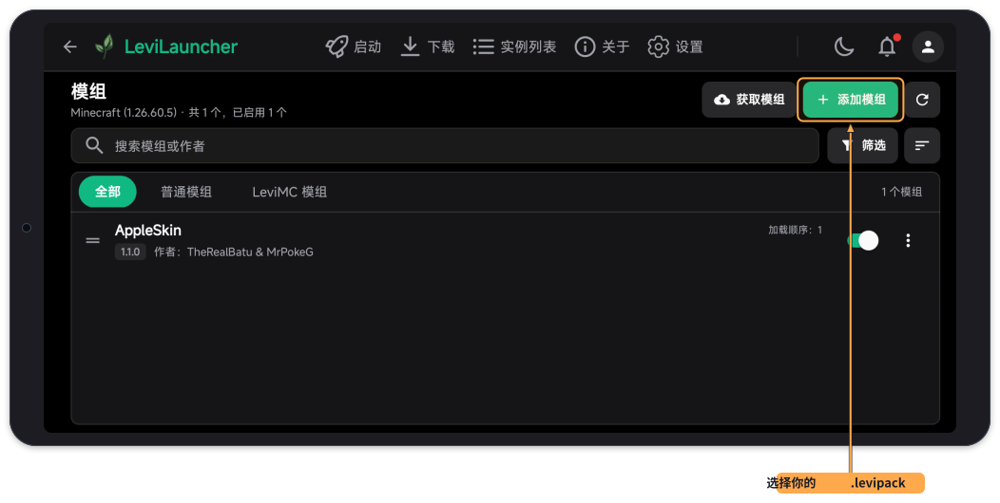

# 你的第一个 Android 原生模组

完成本教程后，你将做出一个 Android 端 Minecraft 基岩版原生模组：从官方模板构建 C++ 库，打包为 `.levipack` 导入手机上的 LeviLauncher，并在游戏启动时向 Android 日志写入一行自定义文字。这个模组还带有一个可在 LeviLauncher 中修改的设置项。

首次上手大约需要一小时，大部分时间花在安装 Android SDK 上。

::: info Android，而不是 LeviLamina
Android 原生模组由 [Android 版 LeviLauncher](https://levimc.org/zh-Hans/LeviLauncher/guide/mods-integrations?platform=android) 通过 Preloader SDK（[LiteLDev/preloader-android](https://github.com/LiteLDev/preloader-android)）加载，而非由 LeviLamina 加载，并使用独立的 `pl::` API。模组的基本结构（`load()`、`enable()`、`disable()`、`getSelf()`）与[你的第一个 LeviLamina 模组](first-levilamina-mod.md)相同。
:::

## 你需要准备

- 一台 Windows、Linux 或 macOS 电脑，并安装以下工具：
  - [Android Studio](https://developer.android.com/studio)（也可只安装其命令行工具），用于获取 Android SDK 和 NDK；
  - [CMake](https://cmake.org/download/) 3.22 或更高版本，以及 [Ninja](https://github.com/ninja-build/ninja/releases)；
  - [PowerShell 7](https://learn.microsoft.com/zh-cn/powershell/scripting/install/installing-powershell)（Windows 上也可以使用 Windows PowerShell）；
  - 本机 C++ 编译器：Windows 上安装勾选了 **使用 C++ 的桌面开发** 的 Visual Studio，Linux 和 macOS 上安装 GCC 或 Clang。构建时会在电脑上运行一个小程序，用来生成模组的默认配置；
  - [Git](https://git-scm.com)。
- 一部 ARM64 架构的 Android 手机（Android 9 或更高版本），已安装 Google Play 版 Minecraft 和 Android 版 LeviLauncher，详见[在 Android 上玩模组](../play/play-with-mods-android.md)。
- 可选：[Android 平台工具](https://developer.android.com/tools/releases/platform-tools)（`adb`），并在手机上开启 USB 调试，用于查看日志。
- C++ 基础。

## 1. 安装 SDK 和 NDK

1. 在 Android Studio 中打开 **Settings** → **Languages & Frameworks** → **Android SDK**。在 **SDK Platforms** 中勾选 **Android 9.0 (API 28)**。在 **SDK Tools** 中勾选 **Show Package Details**，并在 **NDK (Side by side)** 下勾选 `28.2.13676358`，点击应用。
2. 记下页面顶部的 **Android SDK Location**，例如 `C:\Users\<you>\AppData\Local\Android\Sdk`。
3. 新开一个终端，检查其余工具：

   ```powershell
   cmake --version
   ninja --version
   ```

你应该能看到 3.22 或更高版本的 CMake、对应的 Ninja 版本，且 SDK 目录下存在 `ndk\28.2.13676358` 文件夹。

## 2. 从模板创建仓库

1. 打开 [levilauncher-android-mod-template](https://github.com/QYCottage/levilauncher-android-mod-template)，点击 **Use this template** → **Create a new repository**，例如命名为 `my-android-mod`。
2. 克隆该仓库：

   ```powershell
   git clone https://github.com/<you>/my-android-mod
   cd my-android-mod
   ```

3. 目录中应该包含 `CMakeLists.txt`、`manifest.json.in`、`scripts\package.ps1`，以及存有 `MyMod.cpp`、`MyMod.h`、`Config.h` 和 `Config.cpp` 的 `src\mod\` 文件夹。

## 3. 给模组命名

打开 `CMakeLists.txt`。文件靠上的几项设置描述了模组信息，构建时会填入模组的 `manifest.json`。修改这些配置：

```cmake
set(MOD_ID "my_android_mod" CACHE STRING "LeviLauncher mod package directory name")
set(MOD_NAME "My Android Mod" CACHE STRING "LeviLauncher mod display name")
set(MOD_AUTHOR "<you>" CACHE STRING "LeviLauncher mod author")
set(MOD_VERSION "0.1.0" CACHE STRING "LeviLauncher mod version")
set(MOD_LIBRARY_NAME "my_android_mod" CACHE STRING "Native library name without lib prefix or .so suffix")
set(MOD_MINECRAFT_VERSIONS "[\"1.26.*\"]" CACHE STRING "Raw JSON array for manifest minecraft_versions")
```

- `MOD_ID` 是模组在手机上的目录名，也是运行期模组 id。首次发布后请勿更改：LeviLauncher 的文件路径、Mod Menu 归属以及用户保存的设置都依赖这个值。
- `MOD_NAME` 是 LeviLauncher 中显示的名称，同时也是 Android 日志中的标签。
- `MOD_MINECRAFT_VERSIONS` 列出模组适配的游戏版本；`*` 匹配版本号的其余部分，空列表 `[]` 表示适配所有版本。请确保其中包含你手机上的 Minecraft 版本。

模板中的 C++ 命名空间和类分别是 `clange_me` 和 `ClangeMeMod`。你可以日后再重命名，本教程暂不修改。

## 4. 写下你的第一行

模板已内置类型化配置：`src\mod\Config.h` 中的 `ModConfig` 结构体会保存为模组的 `config/config.json`，模组启用时会将其中 `message` 的值写入日志。修改默认消息：

```cpp
struct ModConfig {
    int version = 1;
    bool enabled = true;
    std::string message = "Hello from my first Android mod!";
};
```

打开 `src\mod\MyMod.cpp` 查看该配置的调用位置。模组的生命周期如下：

1. `load()` 在模组加载时运行。模板在此处创建数据和配置文件夹，并加载配置。
2. `enable()` 在游戏启动前运行，通过 `getSelf().getLogger().info(...)` 输出 `Config message: <message>`。
3. `disable()` 在游戏关闭时运行；`unload()` 在最终清理时运行。

`src\main.cpp` 末尾的 `PL_REGISTER_MOD` 注册了模组唯一的常驻实例。

## 5. 构建 .levipack

设置 SDK 位置，然后针对 64 位 ARM 架构运行打包脚本：

::: code-group

```powershell [Windows]
$env:ANDROID_HOME = "C:/Users/<you>/AppData/Local/Android/Sdk"
./scripts/package.ps1 -Abi arm64-v8a
```

```shell [Linux 和 macOS]
export ANDROID_HOME="$HOME/Android/Sdk"     # macOS：$HOME/Library/Android/sdk
pwsh ./scripts/package.ps1 -Abi arm64-v8a
```

:::

在 Windows 上，请在 **Developer PowerShell for VS** 中运行，以便 CMake 找到电脑上的编译器。首次构建会下载 Preloader SDK 和几个依赖库。

构建完成后，应该会生成 `build-arm64-v8a\my_android_mod-0.1.0-arm64-v8a.levipack`。`.levipack` 是一个 ZIP 文件，内含 `my_android_mod\` 文件夹，其中有 `manifest.json`、`libmy_android_mod.so` 和 `config\`。

::: tip 让 GitHub 来构建
模板在 `.github\workflows\build.yml` 中预置了工作流。推送代码后，仓库的 **Actions** 标签页会自动构建 `.levipack` 文件并作为构件（artifact）提供；如果推送 `v*` 标签，还会将构建好的文件附加到发布版本中。
:::

## 6. 导入 LeviLauncher

1. 通过 USB 或其他方式，将 `.levipack` 复制到手机的 **Download**（下载）文件夹。
2. 打开 LeviLauncher，在「启动」页面的「模组」卡片上点击**管理**，进入当前实例的「模组」页面。
3. 点击**添加模组**，在文件选择器中选中你的 `.levipack`。你应该会看到“成功处理 1 个模组文件”的提示。（也可以直接在文件管理器中点击 `.levipack`，选择用 LeviLauncher 打开。）

   

4. 此时模组列表中应该会显示 **My Android Mod**，版本为 `0.1.0`，且启用开关已打开。

初次在 Android 上使用 LeviLauncher？[在 Android 上玩模组](../play/play-with-mods-android.md)会一步步带你完成配置。

## 7. 确认它在运行

1. 从 LeviLauncher 启动游戏。
2. 用 USB 将手机连接到电脑，在电脑上查看 Android 日志：

   ::: code-group

   ```powershell [Windows]
   adb logcat | Select-String "My Android Mod"
   ```

   ```shell [Linux 和 macOS]
   adb logcat | grep "My Android Mod"
   ```

   :::

   你应该能看到一行 `Config message: Hello from my first Android mod!`。

3. 返回 LeviLauncher，打开该模组的详情页。此时页面上已显示配置项：将 **Message** 改为其他内容并保存。重新启动游戏，日志中就会显示修改后的消息。

没有 `adb`？第 3 步依然可以用来验证：配置项之所以会显示出来，正是因为模组已经运行过 `load()` 并保存了配置。

## 你现在有了什么

- 一个 Android 原生模组仓库，支持在本地电脑和 GitHub 上构建 `.levipack`。
- 一个已安装到 LeviLauncher 中的模组，能够写入 Android 日志，并提供可供用户修改的设置项。

## 下一步

- 生命周期详情：[Mod API](https://levimc.org/zh-Hans/LeviLamina/developer_guides/android/api/mod/)。
- 更多带标题、描述和取值范围的设置：[Config API](https://levimc.org/zh-Hans/LeviLamina/developer_guides/android/api/config/)。
- 游戏内的按钮和开关：[Mod Menu API](https://levimc.org/zh-Hans/LeviLamina/developer_guides/android/api/mod_menu/)；触摸和按键：[Input API](https://levimc.org/zh-Hans/LeviLamina/developer_guides/android/api/input/)。
- 修改游戏行为：[Hook API](https://levimc.org/zh-Hans/LeviLamina/developer_guides/android/api/hook/)。
- SDK 头文件与宏：[SDK 头文件与宏](https://levimc.org/zh-Hans/LeviLamina/developer_guides/android/api/types_and_macros/)。
- 包含 Mod Menu、按钮和图片的完整示例：[LiteLDev/LeviLauncher-Android](https://github.com/LiteLDev/LeviLauncher-Android) 中的 `examples/full-cpp-mod`。
- 从玩家视角了解 LeviLauncher 中的原生模组：[模组与集成](https://levimc.org/zh-Hans/LeviLauncher/guide/mods-integrations?platform=android)。
