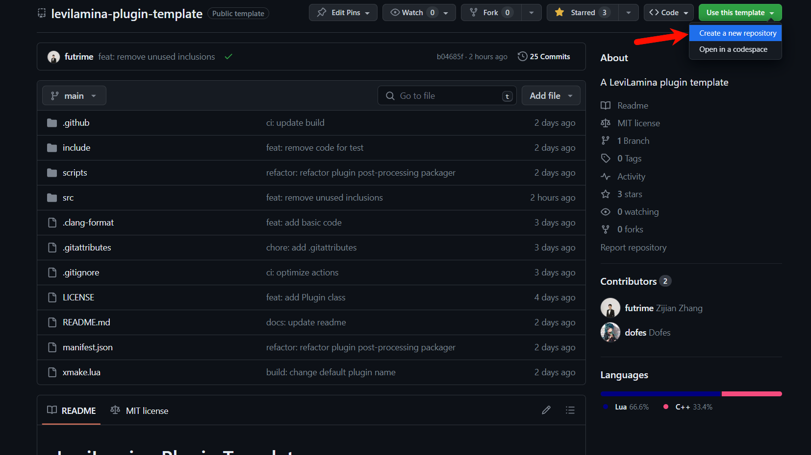

# 你的第一个 LeviLamina 模组

完成本教程后，你将拥有一个用 C++ 编写的 LeviLamina 模组：从官方模组模板创建仓库，在本地编译构建，并加载到你的服务器中。模组启动时会在服务器控制台输出一行日志，并注册一个 `/hello` 命令，向执行者问好。

第一次操作大约需要一小时，大部分时间会花在安装工具，以及首次构建时下载 LeviLamina 上。

## 你需要准备

- 一台 Windows 10 或 11 电脑（x64）。模组需使用 Windows 工具链构建。
- C++ 基础。如果你刚开始学 C++，可以从 [cppreference.com](https://en.cppreference.com/) 和 [C++ Developer Roadmap](https://roadmap.sh/cpp) 入手。
- 一个 GitHub 账号，用于从模板创建仓库。
- 一个装有 LeviLamina 的测试服务器，详见[开你的第一个服务器](../server/first-server.md)。本教程以 `D:\servers\survival` 为例。

## 1. 安装工具

按默认选项安装以下软件：

1. [Git](https://git-scm.com)。
2. [Visual Studio](https://visualstudio.microsoft.com/)（免费的 Community 版即可）。在安装程序中勾选 **使用 C++ 的桌面开发** 工作负载，以安装所需的 Windows SDK 和 C++ 库。
3. [LLVM](https://github.com/llvm/llvm-project/releases/latest)，下载 `LLVM-<version>-win64.exe` 安装程序。安装时勾选将 LLVM 加入 `PATH`。模板使用 LLVM 的 `clang-cl` 进行编译。
4. [xmake](https://xmake.io)，LeviLamina 模组的构建工具。
5. 代码编辑器（可选）：[Visual Studio Code](https://code.visualstudio.com)，搭配 [C/C++](https://marketplace.visualstudio.com/items?itemName=ms-vscode.cpptools)、[XMake](https://marketplace.visualstudio.com/items?itemName=tboox.xmake-vscode) 和 [clangd](https://marketplace.visualstudio.com/items?itemName=llvm-vs-code-extensions.vscode-clangd) 扩展。

打开一个**新的**终端，检查这些工具是否可用：

```powershell
git --version
clang-cl --version
xmake --version
```

终端应输出三个版本号。如果提示某个命令无法识别，请重新安装对应软件并勾选加入 `PATH`，然后重新打开一个终端。

## 2. 从模板创建仓库

1. 打开 [LiteLDev/levilamina-mod-template](https://github.com/LiteLDev/levilamina-mod-template)，点击 **Use this template** → **Create a new repository**。输入仓库名称（例如 `my-mod`）；如果日后打算发布，请将仓库设为公开（public）。

   

2. 将仓库克隆到本地项目目录：

   ```powershell
   mkdir D:\projects
   cd D:\projects
   git clone https://github.com/<you>/my-mod
   cd my-mod
   ```

3. 目录中应包含 `xmake.lua`、`lip.toml`、`manifest.json` 等文件，以及含有 `MyMod.cpp` 和 `MyMod.h` 的 `src\mod\` 文件夹。

## 3. 给模组命名

1. 打开 `xmake.lua`。其中的 `target` 就是模组名称：LeviLamina 会显示该名称，模组的文件夹也以此命名。名称可使用字母、数字和 `-`，不能包含空格：

   ```lua
   target("my-mod") -- Change this to your mod name.
   ```

   本教程保留默认的 `my-mod`。

2. 在同一文件中，固定构建所用的 LeviLamina 版本。其前两段版本号必须与服务器上的 LeviLamina 一致。要查看服务器的版本，可在服务器目录中运行 `lip list`，输出中会有一行形如 `github.com/LiteLDev/LeviLamina@26.60.3`。然后写入：

   ```lua
   add_requires("levilamina 26.60.*", {configs = {target_type = get_config("target_type")}})
   ```

3. 修改 `LICENSE` 中的版权人，或替换为你想用的许可证。模板本身采用 CC0，你可以自由处置。

你也可以重命名 `src\mod\` 中的命名空间 `my_mod` 和类 `MyMod`，本教程不做修改。

## 4. 构建空模组

编写代码前，先确认模板能否正常构建。在仓库目录中运行：

```powershell
xmake f -y -p windows -a x64 -m release
xmake
```

第一条命令将构建目标配置为服务端模组（这是默认值；若要构建客户端模组，可传入 `--target_type=client`）。首次运行时会自动下载 LeviLamina 及其依赖，耗时几分钟。第二条命令执行编译。

编译完成后，最后一行应显示 `build ok`，并生成 `bin\my-mod\` 文件夹，内含 `my-mod.dll` 和 `manifest.json`。

::: details 下载失败
xmake 从 GitHub 下载依赖包。如果无法直接访问 GitHub，请为 xmake 配置 [GitHub 镜像代理](https://xmake.io/zh/guide/package-management/network-optimization.html#mirror-proxy)或 [HTTP 代理](https://xmake.io/zh/guide/package-management/network-optimization.html#proxy-setting)，然后重新运行上述两条命令。如果 xmake 找不到你指定的 LeviLamina 版本，请运行 `xmake repo -u` 更新包索引。
:::

## 5. 添加日志和命令

LeviLamina 会依次调用模组的三个生命周期阶段：`load()`、`enable()` 和 `disable()`。调用 `load()` 时游戏尚未就绪，因此这里只适合做与游戏无关的初始化（如读取配置文件）。命令注册和事件监听应放在 `enable()` 阶段。

命令需要在游戏触发 `ServerCommandRegisterEvent` 事件时注册。将 `src\mod\MyMod.cpp` 的内容替换为：

```cpp
#include "mod/MyMod.h"

#include "ll/api/command/CommandHandle.h"
#include "ll/api/command/CommandRegistrar.h"
#include "ll/api/event/EventBus.h"
#include "ll/api/event/command/ServerCommandRegisterEvent.h"
#include "ll/api/mod/RegisterHelper.h"
#include "mc/server/commands/CommandOrigin.h"
#include "mc/server/commands/CommandOutput.h"
#include "mc/server/commands/CommandPermissionLevel.h"
#include "mc/world/actor/player/Player.h"

namespace my_mod {

MyMod& MyMod::getInstance() {
    static MyMod instance;
    return instance;
}

bool MyMod::load() {
    getSelf().getLogger().debug("Loading...");
    return true;
}

bool MyMod::enable() {
    getSelf().getLogger().info("Hello from my first mod!");

    using namespace ll::event;
    EventBus::getInstance().emplaceListener<ServerCommandRegisterEvent>([](ServerCommandRegisterEvent&) {
        auto& command = ll::command::CommandRegistrar::getInstance(false) // false：服务端命令
                            .getOrCreateCommand("hello", "Says hello.", CommandPermissionLevel::Any);
        command.overload().execute([](CommandOrigin const& origin, CommandOutput& output) {
            auto* entity = origin.getEntity();
            if (entity == nullptr || !entity->isPlayer()) {
                output.success("Hello, console!"); // 由控制台或命令方块执行
                return;
            }
            auto* player = static_cast<Player*>(entity); // 安全：上面已检查 isPlayer()
            output.success("Hello, {}!", player->getRealName());
        });
    });
    return true;
}

bool MyMod::disable() {
    getSelf().getLogger().debug("Disabling...");
    return true;
}

} // namespace my_mod

LL_REGISTER_MOD(my_mod::MyMod, my_mod::MyMod::getInstance());
```

代码解析：

- `getLogger().info(...)` 向服务器控制台输出一行带有模组名称标记的日志。
- `emplaceListener` 订阅事件。当模组被禁用时，LeviLamina 会自动移除该监听器。
- `getOrCreateCommand` 创建 `/hello` 命令；`CommandPermissionLevel::Any` 允许所有玩家执行（若设为 `GameDirectors` 则仅限管理员）。
- `overload().execute(...)` 为 `/hello` 添加无参重载，并指定命令执行时的回调逻辑。

::: warning 游戏类型没有 RTTI
Minecraft 编译时未启用运行时类型信息（RTTI），因此不能对游戏类使用 `dynamic_cast`。请先检查类型（如代码中的 `isPlayer()`），再使用 `static_cast`。
:::

再次运行 `xmake` 构建，确认输出 `build ok`。

## 6. 在服务器上加载模组

1. 如果服务器正在运行，先将其停止。
2. 将 `bin\my-mod` 文件夹复制到服务器的 `mods` 目录下，使其路径为 `D:\servers\survival\mods\my-mod\my-mod.dll`：

   ```powershell
   Copy-Item -Recurse -Force bin\my-mod D:\servers\survival\mods\
   ```

3. 按照[开你的第一个服务器](../server/first-server.md)中的方式启动服务器，或在服务器目录中运行 `lip run`。
4. 在 LeviLamina 加载模组的日志下方，你应该能看到一行包含 `[my-mod]` 和 `Hello from my first mod!` 的输出。
5. 在服务器控制台输入 `hello`（控制台命令不加 `/`），应输出 `Hello, console!`。
6. 打开 Minecraft 加入服务器（地址 `127.0.0.1`，端口 `19132`），在聊天栏输入 `/hello`，应显示 `Hello, <你的名字>!`。

后续每次修改代码后，只需停止服务器、运行 `xmake`、重新复制文件夹，再启动服务器即可。

::: tip 模组没有加载时的错误码
如果 LeviLamina 未能加载 `my-mod`，并报出 126 或 127 等错误码，通常是因为模组构建所用的 LeviLamina 版本与服务器不一致。请核对第 3 步中固定的版本号。有关这些错误码的说明，请参阅 [LeviLamina 故障排除](https://levimc.org/zh-Hans/faq/server/levilamina/errors/)。
:::

## 你现在有了什么

- 一个存放模组源码、可用 `xmake` 构建的 Git 仓库。
- 一个已加载到服务器中、能输出日志并注册命令的模组。
- 配置好的 `lip.toml` 和 `.github\workflows\` 发布工作流，随时可以发布模组。

## 下一步

- 让他人通过一条命令安装你的模组：[用 lip 发布你的模组](publish-a-package.md)。
- 涵盖配置文件、数据库、表单和物品的完整示例：[ShrBox/ExampleMod](https://github.com/ShrBox/ExampleMod)。
- 定义带参数的命令：[命令指南](https://levimc.org/zh-Hans/LeviLamina/developer_guides/how_to_guides/command_guide/)。
- 响应玩家行为：[事件指南](https://levimc.org/zh-Hans/LeviLamina/developer_guides/how_to_guides/event_guide/)。
- 向玩家展示对话框：[表单指南](https://levimc.org/zh-Hans/LeviLamina/developer_guides/how_to_guides/form_guide/)。
- 修改游戏原有逻辑：[Hook 指南](https://levimc.org/zh-Hans/LeviLamina/developer_guides/how_to_guides/hook_guide/)。
- 查阅所有类与函数：[LeviLamina API](https://levimc.org/LeviLamina/api/)。
- 开发者常见问题：[开发者 FAQ](https://levimc.org/zh-Hans/faq/develop/levilamina/basics/)。
- 倾向于使用脚本语言：[你的第一个脚本插件](first-script-plugin.md)。
