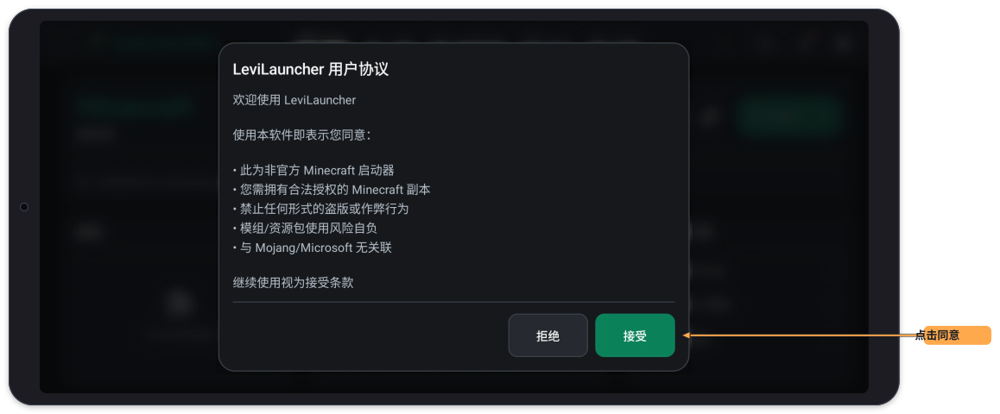
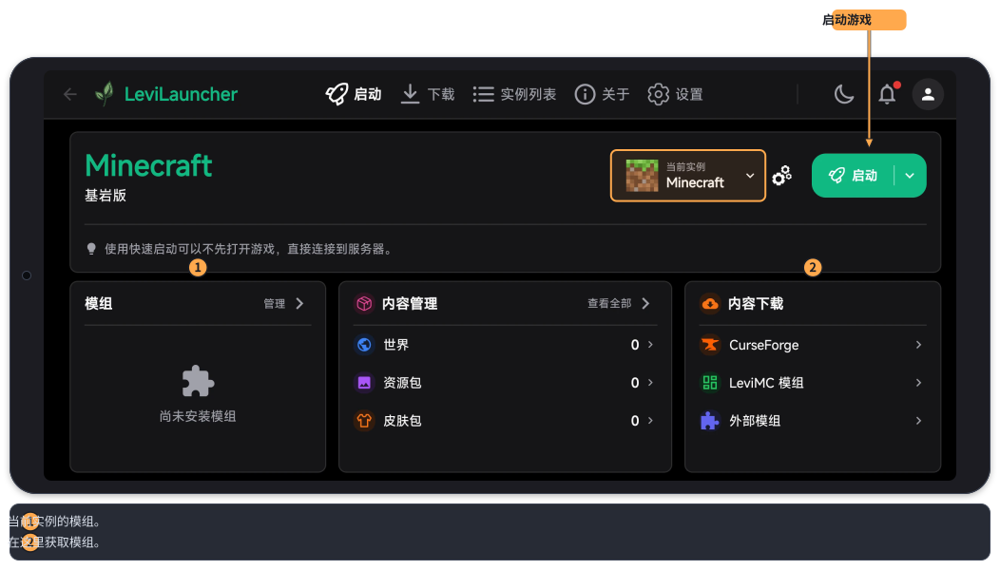
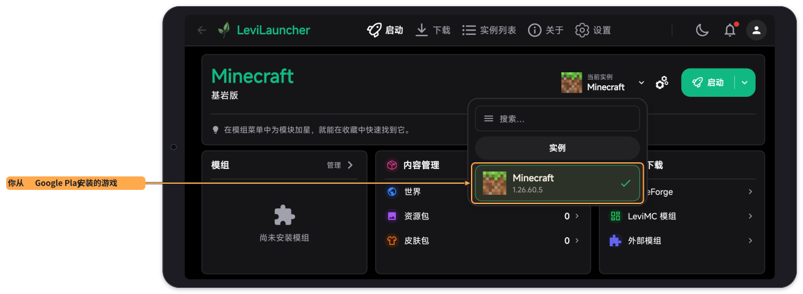
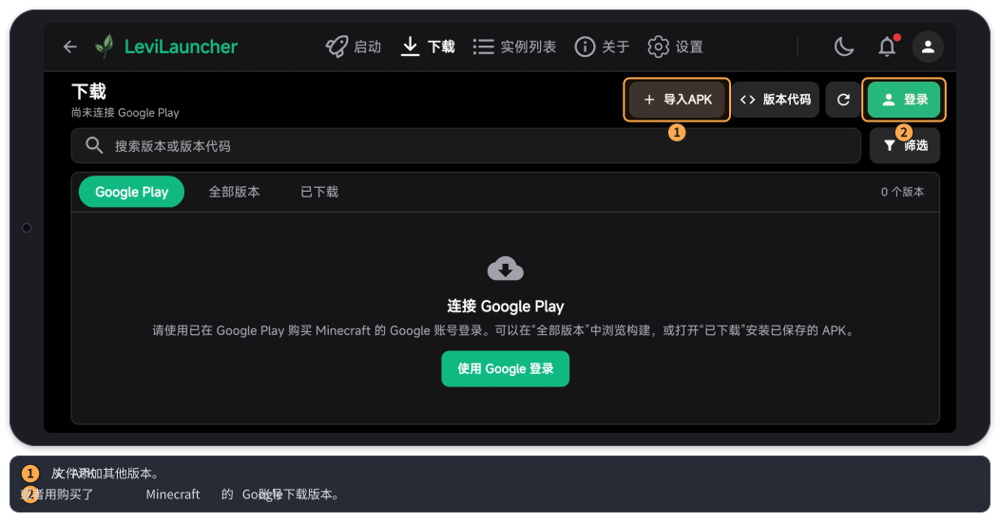
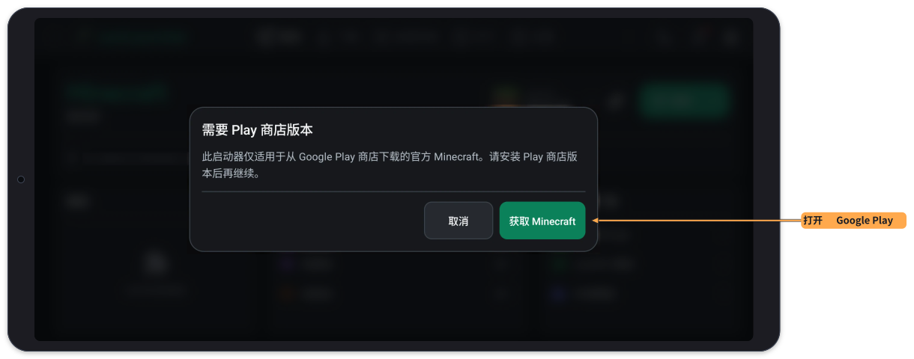
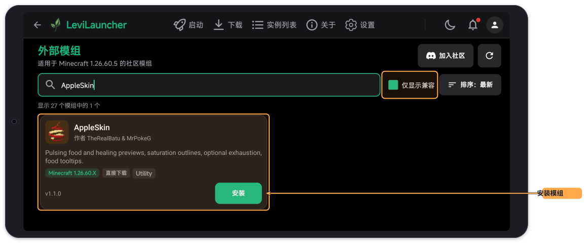
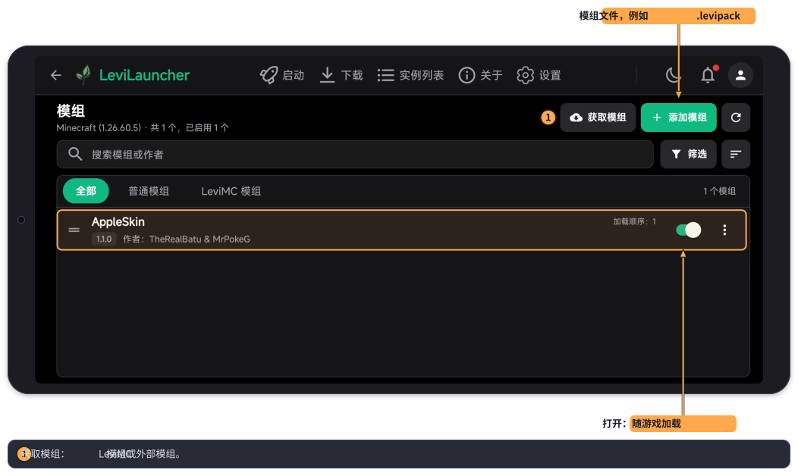
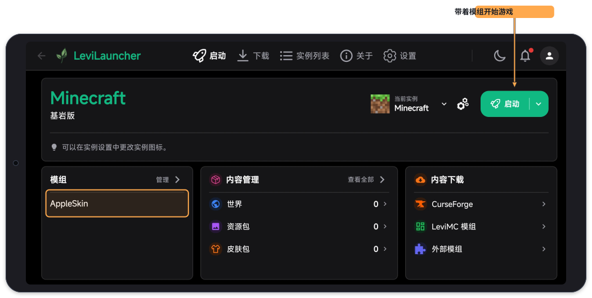
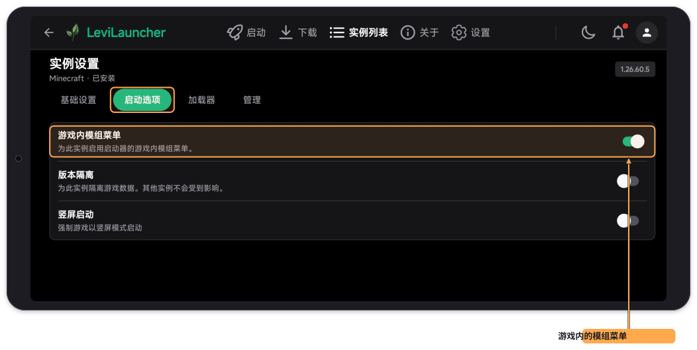
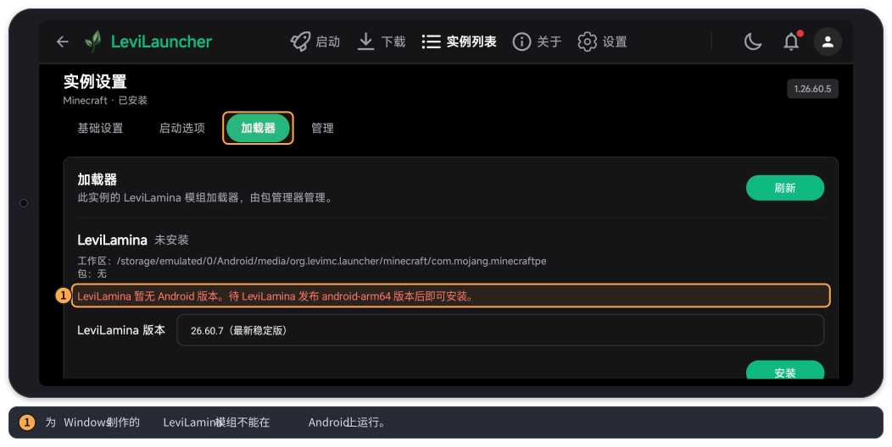

# 在 Android 上玩模组

学完这篇教程，你会在 Android 手机或平板上，从 LeviLauncher 启动带有一个模组（AppleSkin）的 Minecraft 基岩版。LeviLauncher 使用你在 Google Play 上购买的 Minecraft，帮你安装模组，并让每个实例的模组互不干扰：不需要别的东西。

Android 上的模组是为 Android 制作的原生模组。LeviLamina 和为 Windows 制作的 LeviLamina 模组不能在 Android 上运行（详见第 7 步）。

## 你需要准备

- 一台 Android 9 或更高版本、64 位 ARM 处理器（ARM64）的手机或平板。近几年的手机几乎都是。
- Minecraft 基岩版 1.21.80 或更高版本，**在 Google Play 上购买并安装**在这台设备上。LeviLauncher 只是启动你的游戏，不能代替游戏授权；从其他地方安装的 Minecraft 无法使用。
- 网络连接。

## 1. 安装 LeviLauncher

1. 在手机上打开 [Android 版 LeviLauncher 的最新发行版](https://github.com/LiteLDev/LeviLauncher-Android/releases/latest)，下载 `LeviLauncher-v….apk`（文件名以 `-release.apk` 结尾的那个）。
2. 打开下载的文件。如果 Android 提示浏览器不允许安装应用，点击**设置**，打开**允许来自此来源的应用**（浏览器的“安装未知应用”设置），返回后点击**安装**。
3. 打开 LeviLauncher。你会先看到“正在打开启动器…”，然后是用户协议。

历史版本和更新方式：见[安装 LeviLauncher](https://levimc.org/zh-Hans/LeviLauncher/install?platform=android)。

## 2. 完成首次启动

1. 阅读 **LeviLauncher 用户协议**，点击**接受**。

   

2. 如果弹出**新增内容**，点击**继续**。
3. 现在你会看到**启动**页面。顶部的导航栏通往**启动**、**下载**、**实例列表**、**关于**和**设置**。右上角的圆形按钮用来登录 Microsoft 账号，这篇教程用不到。

   

## 3. 检查你的游戏

实例是带有独立模组的一个游戏版本。LeviLauncher 会找到你从 Google Play 安装的 Minecraft，显示为实例 **Minecraft**。

1. 在**启动**页面查看**当前实例**，上面显示 **Minecraft**。
2. 点击它。列表中会列出你的游戏和版本号（例如 `1.26.60.5`），旁边带有勾号。点击列表外部关闭列表。

   

如果列表是空的，说明还没有安装 Minecraft：请从 Google Play 安装，然后重新打开 LeviLauncher。

::: tip 其他游戏版本
除了 Google Play 上的版本，你还可以玩其他版本。在**下载**页面，点击**导入APK**从 APK 文件添加版本，或者点击**登录**，用购买了 Minecraft 的 Google 账号从 Google Play 下载版本。每个版本都会成为一个独立的实例，存档世界与你平时玩的游戏互不影响。这些版本仍然要求设备上装有 Google Play 版游戏。这篇教程用不到它们。

:::

## 4. 先启动一次游戏

1. 在**启动**页面点击**启动**。
2. Minecraft 启动后，你会看到标题画面。然后关掉游戏，下一步来添加模组。

先不带模组启动一次，能确认游戏本身没有问题。这样之后如果遇到问题，就能确定是模组引起的。

如果 LeviLauncher 显示**需要 Play 商店版本**，说明设备上的 Minecraft 不是从 Google Play 安装的。点击**获取 Minecraft**，用购买了游戏的账号从 Google Play 安装，再点击**启动**。如果显示**不支持的版本**，请在 Google Play 上更新 Minecraft：LeviLauncher 需要 1.21.80 或更高版本。

## 5. 安装模组

1. 在**启动**页面的**内容下载**卡片中，点击**外部模组**。这里列出了社区为 Android 制作、且适用于当前实例版本的模组。
2. 保持勾选**仅显示兼容**，这样只会显示适用于当前游戏版本的模组。点击搜索框，输入 `AppleSkin`。
3. 在 AppleSkin 卡片上点击**安装**。屏幕上会提示“已安装 AppleSkin”，按钮变成**已安装**。

   

4. 回到**启动**页面，点击**模组**卡片上的**管理**。**模组**页面列出了 AppleSkin 及其版本，旁边的开关处于打开状态，表示模组会随游戏加载。

   

如果列表里没有 AppleSkin，说明它还没有适配你当前游戏版本的构建：请从列表里换一个模组，或者更新 Minecraft。

**外部模组**中的部分模组需要从作者页面下载：它们的按钮显示为**打开链接**，点击后会先弹出**外部下载**或**广告支持的下载**。在对话框中点击**打开链接**，只下载页面里的模组文件（`.levipack` 或 `.so` 文件），然后回到**模组**页面，点击**添加模组**并选择该文件。你会看到“成功处理 1 个模组文件”。你也可以直接在文件管理器中打开 `.levipack`，选择用 LeviLauncher 打开。

## 6. 带着模组玩

1. 在**启动**页面上，**模组**卡片现在列出了 AppleSkin。点击**启动**。

   

2. Minecraft 会带着 AppleSkin 启动。进入一个世界，看看饥饿值：当你手持食物时，AppleSkin 会显示它能恢复多少饥饿值。

建议一次只添加一个模组，每添加一个就启动游戏测试一次。如果游戏无法启动，先去**模组**页面关掉最新添加的那个模组。

::: tip 游戏内的模组菜单
LeviLauncher 会在游戏中加入一个悬浮按钮，用来打开模组及其选项菜单。要开启或关闭这个按钮，请在**启动**页面点击**当前实例**旁边的齿轮打开**实例设置**，进入**启动选项**，切换**游戏内模组菜单**开关。

:::

## 7. 了解哪些能在 Android 上运行

LeviLamina 是面向 Windows 版游戏和服务器的模组加载器。它的模组是为 Windows 构建的，无法在 Android 上运行；LeviLamina 本身也还没有 Android 版本（在**实例设置**的**加载器**标签页尝试安装时，就会看到这一提示）。请使用**外部模组**中的模组，或其他专为 Android 制作的模组。

**内容下载**卡片中的 **LeviMC 模组**会列出 [LeviMC Mods](https://levimc.org/mods/) 中带有 Android 构建（`android-arm64`）的包。目前还没有这类包，所以列表暂时为空。

## 你现在有了

- LeviLauncher，能带着模组启动你在 Google Play 上购买的 Minecraft。
- 安装在当前实例中的 AppleSkin，随时可以用开关启用或停用。

## 下一步

- 实例的方方面面：其他版本、版本隔离、重命名和删除：[版本管理](https://levimc.org/zh-Hans/LeviLauncher/guide/version-management?platform=android)。
- 世界、资源包和皮肤包，以及导入、导出和备份：[内容管理](https://levimc.org/zh-Hans/LeviLauncher/guide/content-management?platform=android)。
- 模组、CurseForge 和原生模组：[模组与集成](https://levimc.org/zh-Hans/LeviLauncher/guide/mods-integrations?platform=android)。
- 游戏无法启动时：[更新与故障排查](https://levimc.org/zh-Hans/LeviLauncher/guide/update-troubleshooting?platform=android)。
- 自己为 Android 制作模组：[你的第一个 Android 原生模组](../develop/first-android-mod.md)。
- 在电脑上玩模组：[在 Windows 上玩模组](./play-with-mods.md)。
