# 在 Windows 上玩模组

学完这篇教程，你会在 Windows 上玩到装有 LeviLamina 和一个模组的 Minecraft 基岩版。它运行在 LeviLauncher 的一个实例里，世界和设置与你平时玩的游戏互不干扰。游戏版本、LeviLamina 和模组都由 LeviLauncher 帮你安装：不需要 `lip`，也不需要其他工具。

## 你需要准备

- 64 位的 Windows 10 或 Windows 11。
- 当前登录的 Microsoft 账号购买过 Minecraft 基岩版，并且至少在这台电脑上从 Microsoft Store 安装过一次。LeviLauncher 只负责管理游戏，不能代替游戏授权。
- 网络连接。

## 1. 安装 LeviLauncher

1. 打开 [LeviLauncher 的最新发行版](https://github.com/LiteLDev/LeviLauncher/releases/latest)，下载 `LeviLauncher-amd64-installer.exe`。
2. 运行安装程序，完成安装向导。如果提示需要安装 WebView2 或其他组件，请允许它继续。
3. 启动 LeviLauncher。你会看到主窗口左侧有一列图标：**启动**、**下载**、**实例列表**、**关于**和**设置**（把鼠标指向图标就能看到名称）。第一次启动时，默认打开的是**首次启动引导**。

关于发行版里的其他文件、测试版和更新方式，见[安装 LeviLauncher](https://levimc.org/zh-Hans/LeviLauncher/install?platform=windows)。

## 2. 完成首次启动

1. 在**首次启动引导**里，**内容路径**下的**根目录**是 LeviLauncher 存放实例的位置。请确保所在磁盘还有几 GB 空间。如需更改，点**选择…**，选一个文件夹，再点**应用**。**语言**用于设置 LeviLauncher 的界面语言。

   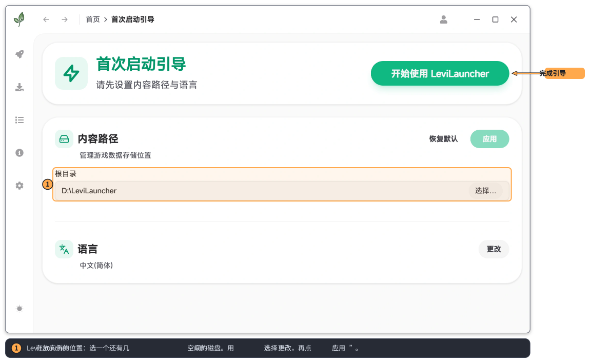

2. 点击**开始使用 LeviLauncher**。
3. LeviLauncher 会显示 **LeviLauncher 用户协议**。读完后，等按钮变为可点击状态时点**同意并继续**。
4. LeviLauncher 会询问**愿意帮助我们改进 LeviLauncher 吗？**，即是否允许发送使用情况统计（Google Analytics）。选**同意并开启**或**暂不开启**都可以，之后随时可以在**设置**里更改。

看到**启动**页面，这一步就完成了。因为还没有实例，页面上的大按钮显示为**下载 Minecraft**。

## 3. 安装一个带 LeviLamina 的游戏版本

1. 在侧边栏打开**下载**。
2. 你应该会看到 Minecraft 正式版的 GDK 版本：**GDK**（包类型）和**类型**中的**正式版**默认都已选中。只有受支持的 GDK 版本才能自动安装 LeviLamina。
3. 找到**加载器**一栏显示 LeviLamina 的最新版本，点对应的**下载**。游戏的最新版本往往在 LeviLamina 适配之前就发布了，所以它不一定在第一行。

   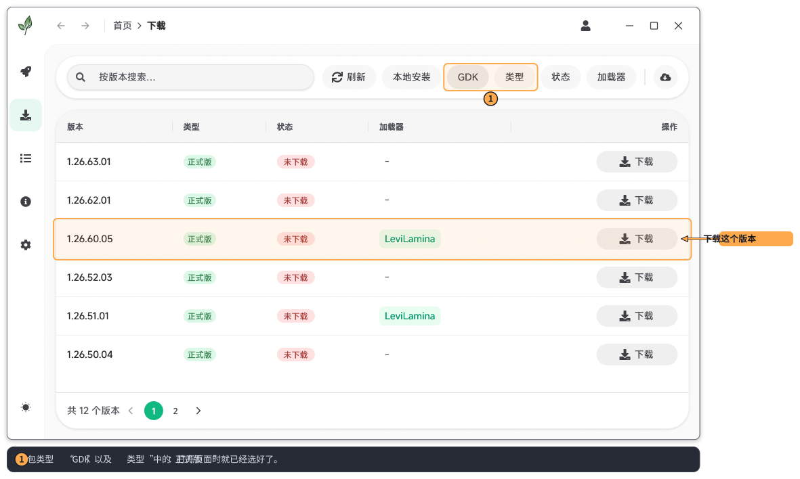

4. 在**选择下载镜像**里，LeviLauncher 会测试各个镜像并自动选中最快的一个。点击**用所选镜像下载**。

   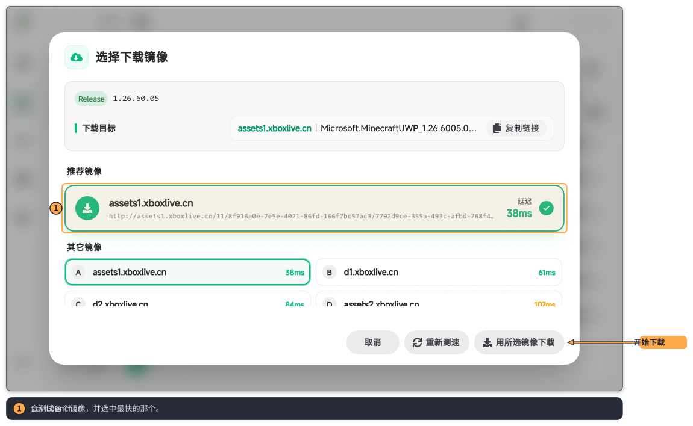

5. 等待下载完成（大约几 GB）。完成后会弹出**下载完成**提示，点击**立即安装**。（之后该版本所在行会显示**已下载**，点那里的**安装**按钮效果相同。）

   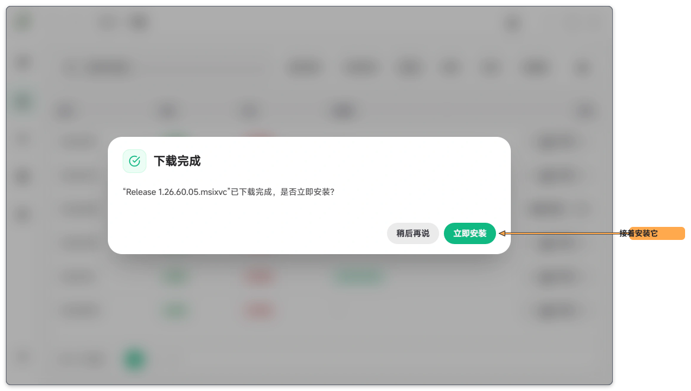

6. 在**安装实例**页面上：
   - 在**实例名称**里给实例起个名字，比如 `Survival`。
   - **安装 LeviLamina** 保持打开，**LeviLamina 版本**保持最新。
   - **实例隔离**保持打开，让这个实例把世界、设置和缓存保存在自己独立的文件夹里。

   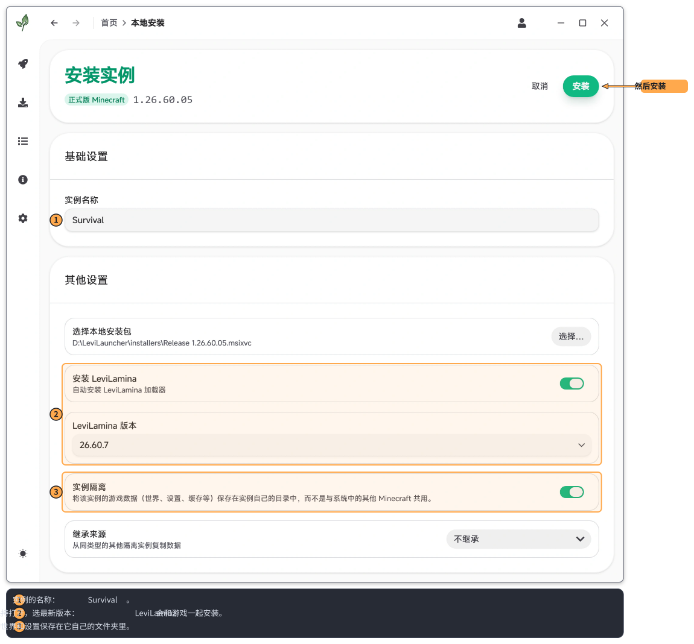

7. 点击页面顶部的**安装**并等待。完成后会显示**安装完成**和“版本已成功安装”。点击**选择实例并前往启动**。

如果页面上没有**安装 LeviLamina**，说明 LeviLamina 不支持这个版本：回到**下载**，选一个**加载器**一栏显示 LeviLamina 的版本。

## 4. 启动游戏

1. 在**启动**页面上，**当前实例**应该就是你刚安装的实例，**Minecraft** 旁边带有一个 LeviLamina 标记。如果不是，请在实例选择器里选中它。

   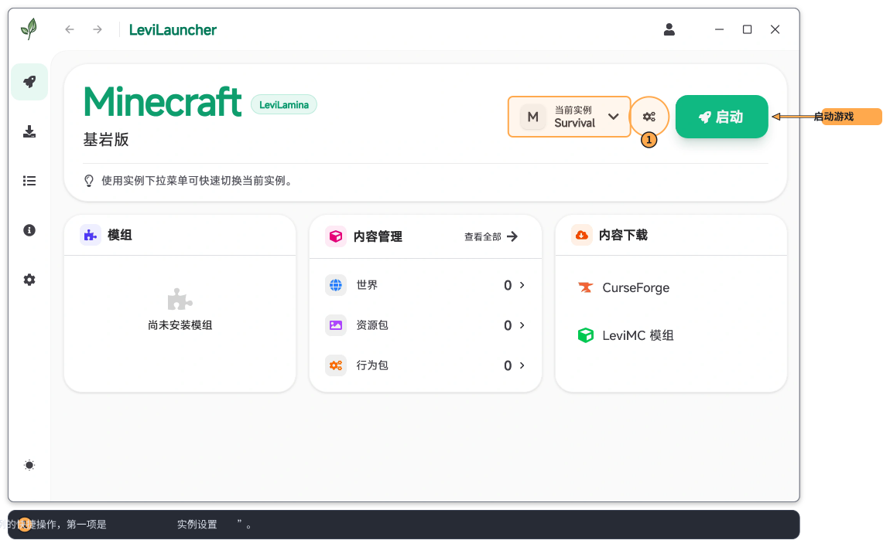

2. 点击**启动**。
3. 如果缺少游戏所需的组件，LeviLauncher 会提示**缺少 GameInput 组件**、**缺少 Microsoft Gaming Services** 或**缺少 Visual C++ 运行库**。点击**立即安装**（Gaming Services 对应**打开商店进行安装**），按安装程序的提示完成安装，然后再点**启动**。

   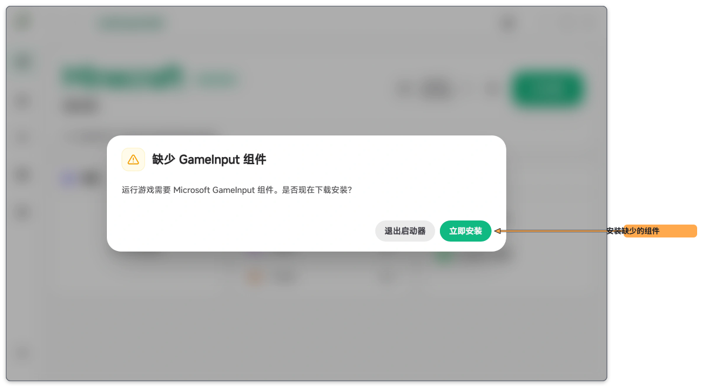

4. Minecraft 启动后，看到标题画面就可以关掉游戏了：下一步我们来添加模组。

如果 LeviLauncher 提示“当前账户没有此版本的授权。”，说明当前使用的 Microsoft 账户没有购买 Minecraft。点击右上角的人像图标（**登录微软账户**；已登录时显示为**切换账户**），登录购买了游戏的账户，然后再启动。

这次不带模组的启动验证了实例本身运行正常。之后如果出现问题，就能确定是模组引起的。

## 5. 安装模组

1. 在**启动**页面上，通过**内容下载**卡片打开 **LeviMC 模组**。这里列出了 [LeviMC 模组](https://levimc.org/zh-Hans/mods/)中提供 Windows 客户端构建、且适用于当前实例中 LeviLamina 的模组。
2. 在**搜索模组…**里输入 `LeviOptimize`，然后打开 LeviOptimize。

   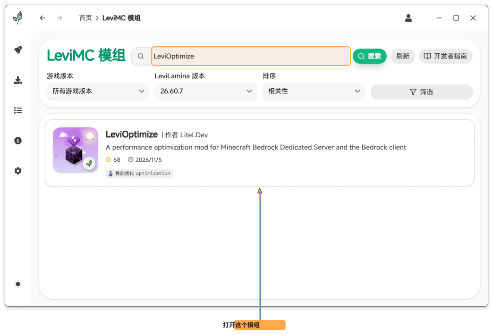

3. 点击**安装**。LeviLauncher 会列出模组的**版本**，变体为 `client`（即游戏客户端所用的构建）。找到适用于你游戏版本的最新版本，点击**安装**。

   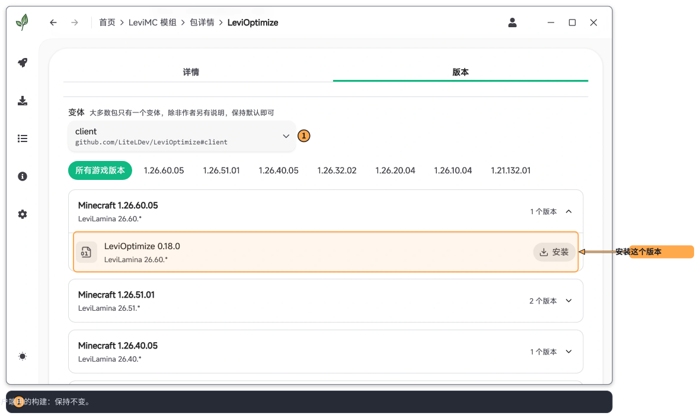

4. 在**选择目标实例**里确认选中了你的实例，然后点击**安装**。LeviLauncher 会自动安装该模组及其所需的依赖。

   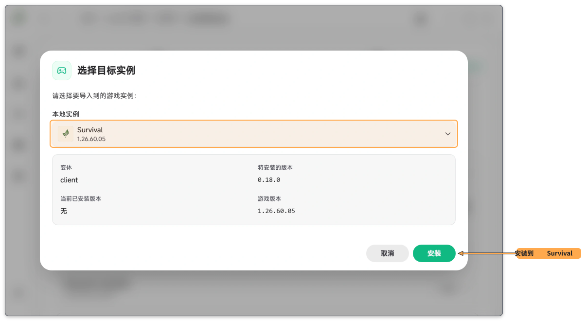

5. 界面会提示“安装成功”。回到**启动**页面，实例的**模组**卡片里已经列出了 LeviOptimize。

如果要添加本地的模组文件，在**模组**卡片上点**管理模组**，再点**导入 .mcmod**。如果是 `.zip` 或单独的 `.dll` 文件，请在文件选择框里选择**所有文件 (\*.\*)**。

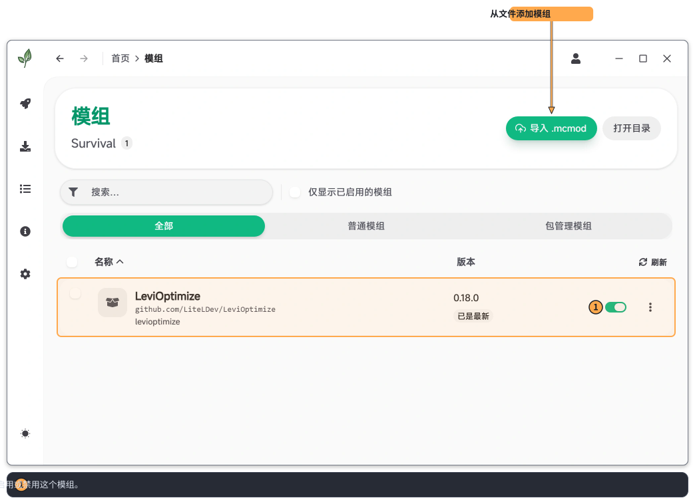

## 6. 带着模组游玩

1. 在**启动**页面确认**当前实例**无误，点击**启动**。
2. Minecraft 启动时会一并加载 LeviLamina 和 LeviOptimize。打开一个世界开始玩吧。

建议以后每次只添加一个模组，加完就启动游戏测试一次。如果游戏无法启动，先去**模组**页面（**管理模组**）用开关禁用刚添加的模组。

::: tip 以后更改 LeviLamina
要在已有实例里安装、更新或移除 LeviLamina，可在**启动**页面点击实例选择器旁边的齿轮按钮（实例的快捷操作），选择**实例设置**，再进入**加载器**标签页。如果 LeviLamina 不支持当前游戏版本，标签页里会显示“该游戏版本不支持 LeviLamina”。

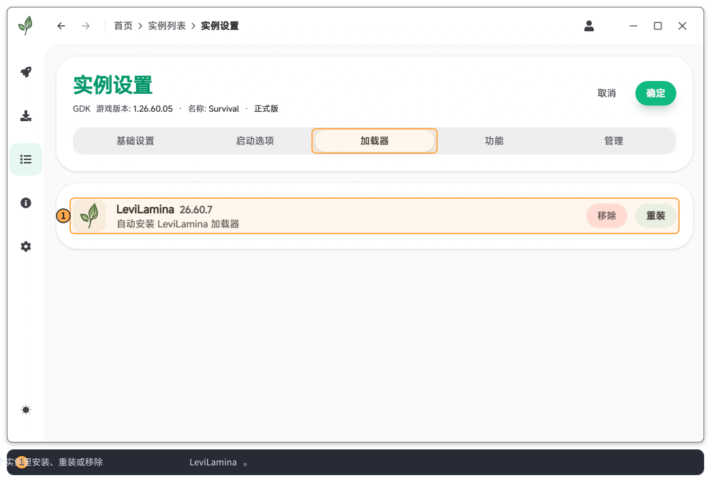
:::

## 你现在有了什么

- LeviLauncher，用来安装和启动各个版本的 Minecraft。
- 一个独立的实例，装有 LeviLamina 和 LeviOptimize，世界和设置与你平时玩的游戏互不干扰。

## 下一步

- 加入带模组的服务器，或自己开服：[开你的第一个服务器](../server/first-server.md)。
- 了解启动器的全部模组功能，包括 CurseForge 和内置包管理器：[模组与集成](https://levimc.org/zh-Hans/LeviLauncher/guide/mods-integrations)。
- 镜像、下载列表和本地安装包：[下载与镜像](https://levimc.org/zh-Hans/LeviLauncher/guide/downloads-mirrors)。
- 重命名、删除和整理实例：[版本管理](https://levimc.org/zh-Hans/LeviLauncher/guide/version-management)。
- 世界、资源包和行为包：[内容管理](https://levimc.org/zh-Hans/LeviLauncher/guide/content-management)。
- 下载失败或游戏无法启动时：[更新与故障排查](https://levimc.org/zh-Hans/LeviLauncher/guide/update-troubleshooting)。
- 在 Android 手机或平板上游玩：[在 Android 上玩模组](./play-with-mods-android.md)。
- 自己制作模组：[你的第一个 LeviLamina 模组](../develop/first-levilamina-mod.md)。
